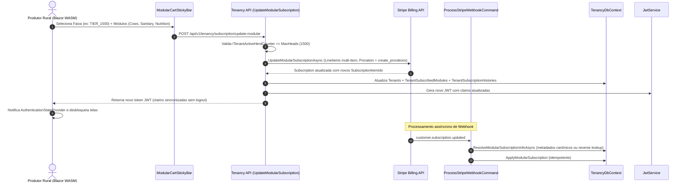

# Modular Self-Service Feature Gating & Licensing Architecture Guide

## Objective
Implement modular monolith self-service feature gating (`À La Carte`) and tiered head capacity limits (`HeadTierCapacityLimits`), decoupling module authorization from legacy static subscription plans (`Starter`, `Pro`, `Enterprise`).

---

## 1. Modular Gating & Core vs. Add-on Modules

The system authorizes module access via `ModuleLicenseChecker.HasModuleAccess(IEnumerable<string>? subscribedModules, string? requiredModule)` using the tenant's active `SubscribedModules` set resolved from JWT claims (`subscribed_module` / `subscribed_modules`):

| Module / Area | Key (`ModuleKey`) | Classification | Access Rule |
| :--- | :---: | :---: | :--- |
| **Gestão do Plantel & Lotes Básicos** | `Cows` | **Core (Obrigatório)** | Always allowed for any active/trial tenant |
| **Identidade & Organização** | `Tenancy` | **Core (Sistema)** | Always allowed |
| **Reprodução, IATF & DG** | `Breeding` | Add-on Self-Service | Requires `"Breeding"` in `SubscribedModules` |
| **Maternidade, Partos & Desmama** | `Calving` | Add-on Self-Service | Requires `"Calving"` in `SubscribedModules` |
| **Recria, Engorda, Pesagens & Pastos** | `Growth` | Add-on Self-Service | Requires `"Growth"` in `SubscribedModules` |
| **Manejo Sanitário & Carência** | `Sanitary` | Add-on Self-Service | Requires `"Sanitary"` in `SubscribedModules` |
| **Nutrição, Silos & Trato TMR** | `Nutrition` | Add-on Self-Service | Requires `"Nutrition"` in `SubscribedModules` |
| **Inteligência Zootécnica & BI** | `Analytics` | Add-on Self-Service | Requires `"Analytics"` in `SubscribedModules` |

### Separation between `Cows` (Base Herd) and `Breeding` (IATF/DG)
- **Plantel Base (`[RequiresModule("Cows")]`):** Basic animal registry (`CreateCowCommand`, `UpdateCowCommand`, `GetCowQuery`, `ListCowsQuery`, `ListBullsQuery`) and basic lot management (`CreateLotCommand`, `MoveLotToPaddockCommand`, `CloseLotCommand`, `GetLotsQuery`) require `"Cows"`.
- **Reprodução Especializada (`[RequiresModule("Breeding")]`):** IATF protocols (`RegisterIatfProtocolCommand`, `GetIatfProtocolsQuery`) and pregnancy diagnoses (`RegisterPregnancyDiagnosisCommand`) require `"Breeding"`. Having `"Cows"` does not grant implicit access to `"Breeding"`.

---

## 2. Head Tier Capacity Limits (`HeadTierCapacityLimits`)

Animal registry capacity is governed by the tenant's contracted head tier (`tenant.HeadTierCode` and `tenant.Capacity`):
- `TIER_500`: up to `500` heads (`Tier500MaxHeads`)
- `TIER_1500`: up to `1,500` heads (`Tier1500MaxHeads`)
- `TIER_3000`: up to `3,000` heads (`Tier3000MaxHeads`)
- `TIER_5000_PLUS`: up to `10,000` heads (`Tier5000PlusMaxHeads`)

### Decoupled Active Herd Capacity Governance (`ITenantActiveHerdCounter`)
To enforce head tier limits without cross-module database coupling:
- Tenancy defines the interface `ITenantActiveHerdCounter`:
  ```csharp
  public interface ITenantActiveHerdCounter
  {
      Task<int> GetActiveHerdCountAsync(Guid tenantId, CancellationToken cancellationToken = default);
  }
  ```
- The API host registers `CompositeActiveHerdCounter`, querying the operational herd count (from `Modules.Breeding` / `Modules.Growth`) via decoupled in-memory queries.
- When registering new animals (`CreateCowCommandHandler`), if the active herd count reaches `ITenantContext.HeadCapacity`, the operation fails immediately with `License.HeadCapacityExceeded` (`ErrorType.Validation`).
- During checkout or subscription changes, if the tenant's active herd exceeds the selected tier's `MaxHeads`, the operation is blocked or redirected to the grace period workflow.

---

## 3. End-to-End Modular Subscription Lifecycle & Stripe Multi-Item Architecture



### Multi-Item Stripe Subscription Mapping
- Rather than a single fixed `PlanId`, each modular subscription consists of multiple `SubscriptionItem` objects on Stripe:
  1. Base Herd Line Item: `Cows` at the selected `HeadTierCode` price (`StripePriceIdMonthly` or `StripePriceIdAnnual`).
  2. N Add-on Line Items: One item per optional module selected at that same tier's price.
- Changes are executed atomically with `ProrationBehavior = "create_prorations"`, ensuring producers receive instant access and are billed or credited proportionally.

---

## 4. Downgrade Grace Period Mechanism (14 Dias)

When a producer requests a downgrade to a head tier lower than their current active herd count:
1. **Immediate Block without Grace (`AllowGracePeriod = false`):**
   - The operation fails with `Result.Failure(License.HeadCapacityExceeded)`.
2. **Grace Period Activation (`AllowGracePeriod = true`):**
   - If allowed, the subscription transitions to `SubscriptionActionType.DowngradeGracePeriodStarted`.
   - The tenant status enters `GracePeriodActive` with a fixed window of 14 days (`GracePeriodEndUtc = UtcNow.AddDays(14)`).
   - During these 14 days, the producer maintains operational access but is alerted to adjust herd size (via sales, transfers or culling).
   - Once the herd count conforms or upon admin resolution, `ResolveModularGracePeriod` clears the grace period state.

---

## 5. Dynamic 1-Click Contextual Upsell (`ModuleGuard.razor`)

Instead of static paywalls, `ModuleGuard.razor` acts as a dynamic upsell engine:
- Evaluates `ModuleLicenseChecker.HasModuleAccess(subscribedModules, Module)`.
- If access is denied:
  - Invokes `ModuleGuardUpsellCalculator.CalculateUpsell(catalog, tenantTier, moduleKey)`.
  - Determines the exact price increment (e.g., `+ R$ 89,00/mês`) for the tenant's current head tier.
  - If the tenant has an active Stripe card on file and the user has administrative privileges, displays a **1-Click Activation Modal**.
  - Upon user confirmation, dispatches `UpdateModularSubscriptionCommand`, updates Stripe via proration, refreshes the active JWT in-memory via `AuthenticationStateProvider`, and immediately unblocks the screen without page reload.
  - For trial or invoice-based accounts, offers a one-click redirect to `/settings/subscription?addModule={Module}` with the cart pre-populated.

---

## 6. Backend Gating Pipeline

Commands and queries requiring module verification are decorated with `[RequiresModule("ModuleName")]`.

```
[Request Object]
       |
       v (MediatR Bus)
 [ModuleAccessBehavior] -- Check RequiresModuleAttribute
       |
       +---> [Yes] Resolve ITenantContext.SubscribedModules
       |            |
       |            +---> ModuleLicenseChecker.HasModuleAccess(SubscribedModules, requiredModule)
       |            +---> Has access? -> Proceed to Handler.
       |            +---> No access? -> Return failed Result.Failure(License.ModuleNotSubscribed).
       v
[Handler Execution]
```

- **Functional Results**: Blocked commands/queries return `Result` or `Result<T>` with `Error.Unauthorized("License.ModuleNotSubscribed", ...)` indicating which module must be added to the subscription.
- **Modular Self-Service Context (`ITenantContext`)**: `ITenantContext` exposes `IReadOnlySet<string> SubscribedModules`, `int HeadCapacity`, and `string? HeadTier`, resolved by `HttpContextTenantContext` from JWT claims (`subscribed_module`, `subscribed_modules`, `head_capacity`, `head_tier`).
