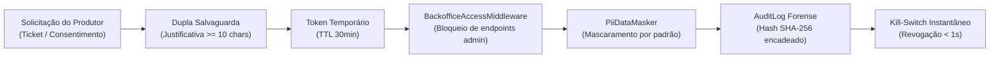
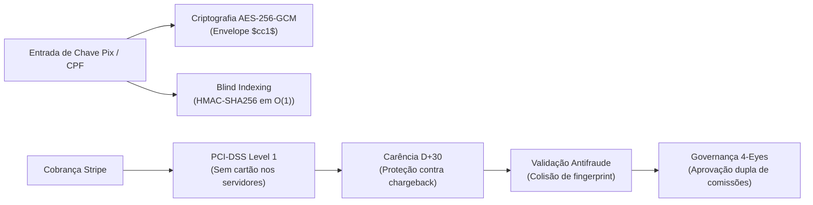

# Relatório de Impacto à Proteção de Dados Pessoais (RIPD / DPIA)

> **Documento Oficial de Avaliação e Mitigação de Riscos**  
> **Plataforma:** CriaCerto Bovino SaaS  
> **Agente de Tratamento:** CriaCerto Tecnologia Agropecuária Ltda.  
> **Fundamentação Legal:** Art. 5º, XVII e Art. 38 da LGPD (Lei nº 13.709/2018) c/c Guia Orientativo da ANPD  
> **Data de Homologação:** Outubro/2026  
> **Status:** Aprovado e Vigente  
> **Encarregado pelo Tratamento de Dados (DPO):** `dpo@criacerto.com.br` | Portal: `/dpo`

---

## 1. Contexto, Delimitação e Metodologia

### 1.1 Objetivo
Este Relatório de Impacto à Proteção de Dados Pessoais (RIPD) tem como finalidade avaliar de maneira sistemática e aprofundada os riscos associados ao tratamento de dados pessoais em funcionalidades críticas da plataforma **CriaCerto Bovino SaaS**, atestando a eficácia e suficiência das medidas mitigadoras técnicas e organizacionais implementadas.

### 1.2 Escopo Prioritário
Embora toda a plataforma observe os 10 princípios fundamentais do Art. 6º da LGPD e esteja inventariada no [ROPA (Art. 37)](file:///home/rony/LPR/CriaCerto/docs/compliance/ropa_data_inventory.md), dois fluxos operacionais apresentam maior sensibilidade e potencial de risco aos direitos dos titulares, demandando este RIPD específico:
1. **Funcionalidade de Impersonação de Suporte e Acesso Administrativo a Contas de Produtores Rurais** (`Modules.Backoffice`).
2. **Processamento Financeiro, Faturamento de Assinaturas (Stripe) e Liquidação de Repasses Pix de Afiliados** (`Modules.Referral` e `Modules.Tenancy`).

### 1.3 Metodologia de Avaliação de Riscos
A metodologia utilizada baseia-se nas diretrizes do **Guia Orientativo da ANPD para Elaboração de RIPD** e nos padrões **ISO/IEC 27701** e **ISO/IEC 29134**:
- **Probabilidade de Ocorrência**: Escala de 1 (Rara) a 5 (Muito Alta).
- **Impacto aos Direitos do Titular**: Escala de 1 (Desprezível) a 5 (Severo / Catastrófico).
- **Nível de Risco**: $\text{Risco} = \text{Probabilidade} \times \text{Impacto}$
  - *Baixo (1 a 6)*: Risco aceitável sob controles operacionais normais.
  - *Médio (7 a 14)*: Risco tolerável mediante salvaguardas adicionais.
  - *Alto (15 a 25)*: Risco inaceitável sem salvaguardas técnicas mandatórias.

---

## 2. Análise Detalhada de Risco 1: Impersonação de Suporte Técnico

### 2.1 Descrição do Processo
Para prestar suporte técnico ágil e diagnosticar falhas complexas em manejos zootécnicos (fechamento de lotes de confinamento, pesagens com GPD incorreto, carência sanitária de vacinas), analistas autorizados do Backoffice podem iniciar uma sessão de suporte assistido (*Impersonation*), espelhando o painel do produtor rural solicitante.

### 2.2 Avaliação do Risco Inerente (Sem Mitigações)
| Cenário de Risco Inerente | Descrição da Ameaça | Probabilidade (1-5) | Impacto (1-5) | Risco Inerente |
|---|---|:---:|:---:|:---:|
| **R1.1 - Abuso de Privilégio por Operador** | Analista de suporte acessa a conta do produtor rural por curiosidade ou sem consentimento, visualizando dados cadastrais e financeiros confidenciais. | 4 | 4 | **16 (Alto)** |
| **R1.2 - Elevação Lateral de Privilégios** | O token de impersonação é capturado ou forjado por terceiro malicioso para invocar endpoints administrativos da API de Backoffice. | 3 | 5 | **15 (Alto)** |
| **R1.3 - Vazamento Visual de PII** | Dados sensíveis (CPF, telefone, faturas) ficam expostos em tela durante o atendimento de suporte ou em capturas de tela não autorizadas. | 4 | 3 | **12 (Médio)** |
| **R1.4 - Inexistência de Rastreabilidade** | O operador realiza alterações zootécnicas ou cadastrais sem que o produtor rural ou a auditoria possam identificar o autor real da modificação. | 3 | 5 | **15 (Alto)** |
| **R1.5 - Sessão Aberta Indeterminadamente** | O operador esquece a sessão de suporte aberta em estação desprotegida, permitindo uso indevido por terceiros. | 4 | 3 | **12 (Médio)** |

---

### 2.3 Salvaguardas Implementadas e Controles Técnicos
Para neutralizar integralmente os riscos identificados, foram implementadas as seguintes barreiras de defesa em profundidade:

1. **Princípio da Dupla Salvaguarda Mandatória**:
   - Uma sessão de impersonação só pode ser aberta se houver autorização prévia documentada do produtor rural (ticket formal de suporte) combinada com a inserção de justificativa operacional fundamentada (mínimo de 10 caracteres) gravada no momento do disparo do comando `StartImpersonationSessionCommand`.
2. **Contenção Estrita em Middleware (`BackofficeAccessMiddleware`)**:
   - A camada de segurança do host da API inspeciona todos os tokens que portam a claim de impersonação (`is_impersonated: true`). Qualquer tentativa de acessar rotas administrativas da URL `/api/v1/backoffice/*` é sumariamente rejeitada com erro HTTP 403 (`Backoffice.ImpersonationRestricted`), impedindo qualquer elevação de privilégios.
3. **Privacidade por Padrão e Mascaramento Contextual**:
   - Todas as exibições de dados pessoais (CPF, e-mails pessoais, CNPJ, dados bancários) são ofuscadas dinamicamente na interface através do serviço `IPiiDataMasker` e do componente `<MaskedDataField>`. A revelação de dados em texto claro requer execução explícita de comando Just-In-Time (`RevealSensitiveDataCommand`) com justificativa individual e severidade `High` no `AuditLog`.
4. **Trilha Forense Imutável e Encadeamento Criptográfico SHA-256**:
   - Cada ação executada durante a sessão é registrada no `AuditLog` com contexto do operador real (`OperatorAdminId`), identificador da fazenda (`TenantId`), timestamp UTC preciso e hash criptográfico SHA-256 encadeado (`RecordHash = SHA256(PreviousRecordHash + RecordData)`), assegurando prova técnica de não-repúdio e detecção imediata de adulteração (`VerifyAuditTrailIntegrityQuery`).
5. **Circuit-Breaker e Kill-Switch Emergencial ([RUNBOOK-01](file:///home/rony/LPR/CriaCerto/docs/operations/runbook_incident_response.md))**:
   - Mecanismo de corte instantâneo de sessões ativas com tempo de resposta inferior a 1 segundo em caso de anomalia, associado ao TTL volátil máximo de 30 minutos por sessão.
6. **Detecção Proativa de Anomalias (`AnomalyDetectionEngine`)**:
   - Monitoramento contínuo emitindo alertas em tempo real para surtos de impersonação (`ALR_IMPERSONATION_BURST`) ou acessos fora da janela de horário operacional autorizada (`ALR_OFF_HOURS_CRITICAL_ACTION`).

### 2.4 Avaliação do Risco Residual (Pós-Mitigações)
| Cenário de Risco | Salvaguardas Específicas | Probabilidade Residual | Impacto Residual | Risco Residual | Classificação |
|---|---|:---:|:---:|:---:|:---:|
| **R1.1 - Abuso de Privilégio** | Dupla salvaguarda, justificativa obrigatória e auditoria forense. | 1 | 2 | **2** | **BAIXO** |
| **R1.2 - Elevação Lateral** | Bloqueio sumário via `BackofficeAccessMiddleware`. | 1 | 3 | **3** | **BAIXO** |
| **R1.3 - Vazamento Visual de PII** | Mascaramento contextual por padrão (`IPiiDataMasker`). | 1 | 2 | **2** | **BAIXO** |
| **R1.4 - Falta de Rastreabilidade** | Encadeamento SHA-256 de todas as ações no `AuditLog`. | 1 | 2 | **2** | **BAIXO** |
| **R1.5 - Sessão Aberta** | TTL fixo de 30 min e Kill-Switch em menos de 1s. | 1 | 2 | **2** | **BAIXO** |

---

## 3. Análise Detalhada de Risco 2: Processamento Financeiro e Afiliados (Referral & Stripe)

### 3.1 Descrição do Processo
O ecossistema realiza a cobrança recorrente de assinaturas SaaS dos produtores rurais através da integração com o gateway de pagamentos Stripe, além de gerenciar o Programa de Afiliados e Parcerias Comerciais (`Modules.Referral`), que calcula comissões sobre faturas adimplentes e liquida repasses monetários aos parceiros via transferências Pix.

### 3.2 Avaliação do Risco Inerente (Sem Mitigações)
| Cenário de Risco Inerente | Descrição da Ameaça | Probabilidade (1-5) | Impacto (1-5) | Risco Inerente |
|---|---|:---:|:---:|:---:|
| **R2.1 - Comprometimento de Dados de Cartão** | Interceptação de dados de cartão de crédito de produtores durante o checkout ou vazamento a partir do banco de dados. | 2 | 5 | **10 (Médio)** |
| **R2.2 - Exposição de Chaves Pix e CPF/CNPJ** | Acesso indevido a tabelas de parceiros comerciais expondo chaves Pix e CPFs em claro por falha em dumps ou injeção SQL. | 3 | 5 | **15 (Alto)** |
| **R2.3 - Fraude e Colisão de Cartão no Referral** | Padrinho cria conta falsa para si mesmo e utiliza o mesmo cartão de crédito para simular vendas e receber comissões indevidas. | 4 | 4 | **16 (Alto)** |
| **R2.4 - Repasse Prematuro e Chargeback** | Pagamento antecipado de comissões de parceiros antes do prazo de estorno de cartão, gerando prejuízo e disputas financeiras. | 4 | 3 | **12 (Médio)** |
| **R2.5 - Manipulação de Comissões por Administrador** | Alteração arbitrária de percentuais de comissão de contrato por analista interno sem dupla autorização. | 3 | 4 | **12 (Médio)** |

---

### 3.3 Salvaguardas Implementadas e Controles Técnicos

1. **Terceirização Segura e Isolamento PCI-DSS Level 1 (Stripe)**:
   - A coleta, tokenização e liquidação de cartões de crédito são executadas diretamente entre o navegador do usuário e os servidores certificados do Stripe Inc. via Stripe Elements. **Nenhum dado sensível de cartão (PAN, CVV, expiração) trafega, transita ou é armazenado nos servidores da CriaCerto**.
   - Todos os webhooks recebidos do Stripe exigem validação criptográfica obrigatória com chave secreta HMAC-SHA256 e proteção contra ataques de repetição.
2. **Criptografia Simétrica Autenticada em Repouso (AES-256-GCM)**:
   - Dados financeiros e cadastrais sensíveis de parceiros comerciais (`PixKey` e `LegalDocumentNumber`) são gravados exclusivamente criptografados no banco de dados através do serviço `AesGcmDataEncryptionService`. O formato canônico `$cc1$` inclui tag de autenticação GCM e suporta rotação de chaveiro sem quebra de integridade.
3. **Blind Indexing (HMAC-SHA256)**:
   - Para permitir validação de unicidade cadastral e consultas pontuais em $O(1)$ sem a necessidade de manter chaves Pix ou CPFs em claro no banco, utiliza-se o padrão internacional de **Blind Indexing** derivado via chave secreta HMAC-SHA256, impedindo a reconstrução reversa do dado original em caso de vazamento da base de dados.
4. **Motor Antifraude e Quarentena Mandatória D+30**:
   - As comissões geradas permanecem obrigatoriamente bloqueadas no estado `PendingMaturity` por 30 dias contados do pagamento da fatura (`ReferralMaturityAndEnforcementWorker`), cobrindo o período de contestação bancária e estornos de cartão.
   - O sistema detecta automaticamente colisões de cartão de crédito (`HasCardFingerprintCollisionAsync`), bloqueando auto-indicações e suspendendo imediatamente parceiros fraudulentos com registro forense no `AuditLog`.
5. **Governança Administrativa dos Quatro Olhos (4-Eyes Principle)**:
   - Nenhuma comissão customizada ou alteração contratual em percentuais de comissão pode ser implementada por um único operador. O fluxo exige solicitação e aprovação independente por outro administrador autorizado (`ApprovalRequestType.UpdatePartnerContractCommission`).
6. **Sanitização de Comprovantes de Repasse**:
   - Os comprovantes bancários de transferências Pix são higienizados contra ataques de *path traversal* e armazenados com chaves aleatórias opacas, acessíveis apenas a operadores com a claim `referral.payouts.read`.

### 3.4 Avaliação do Risco Residual (Pós-Mitigações)
| Cenário de Risco | Salvaguardas Específicas | Probabilidade Residual | Impacto Residual | Risco Residual | Classificação |
|---|---|:---:|:---:|:---:|:---:|
| **R2.1 - Comprometimento de Cartão** | Terceirização estrita via Stripe PCI-DSS Level 1. | 1 | 2 | **2** | **BAIXO** |
| **R2.2 - Exposição de Chaves Pix/CPF** | Cifra **AES-256-GCM** e Blind Indexing **HMAC-SHA256**. | 1 | 2 | **2** | **BAIXO** |
| **R2.3 - Fraude e Colisão de Cartão** | Detecção de fingerprint e bloqueio automático. | 1 | 2 | **2** | **BAIXO** |
| **R2.4 - Repasse Prematuro/Chargeback** | Quarentena D+30 estrita gerida por background worker. | 1 | 2 | **2** | **BAIXO** |
| **R2.5 - Manipulação de Comissões** | Governança 4-Eyes compulsória e trilha SHA-256. | 1 | 2 | **2** | **BAIXO** |

---

## 4. Matriz Comparativa Consolidada de Riscos (Inerente vs Residual)

| ID | Cenário de Tratamento Analisado | Risco Inerente ($\mathbf{P \times I}$) | Risco Residual ($\mathbf{P \times I}$) | Redução Relativa | Parecer de Conformidade |
|:---:|---|:---:|:---:|:---:|:---:|
| **R1.1** | Abuso de Privilégio por Operador de Suporte | 16 (Alto) | **2 (Baixo)** | **-87.5%** | Mitigado por Dupla Salvaguarda e Auditoria |
| **R1.2** | Elevação Lateral de Privilégios com Token | 15 (Alto) | **3 (Baixo)** | **-80.0%** | Bloqueado por Middleware Nativo |
| **R1.3** | Vazamento Visual de PII em Atendimentos | 12 (Médio) | **2 (Baixo)** | **-83.3%** | Mascaramento Contextual por Padrão |
| **R1.4** | Ausência de Rastreabilidade em Alterações | 15 (Alto) | **2 (Baixo)** | **-86.7%** | Encadeamento Criptográfico SHA-256 |
| **R1.5** | Sessão de Impersonação Aberta/Abandonada | 12 (Médio) | **2 (Baixo)** | **-83.3%** | TTL de 30min e Kill-Switch em < 1s |
| **R2.1** | Comprometimento de Cartão de Crédito | 10 (Médio) | **2 (Baixo)** | **-80.0%** | Tokenização Exclusiva Stripe (PCI-DSS) |
| **R2.2** | Exposição de Chaves Pix e CPFs de Parceiros | 15 (Alto) | **2 (Baixo)** | **-86.7%** | AES-256-GCM + Blind Indexing HMAC |
| **R2.3** | Fraude e Auto-Indicação com Mesmo Cartão | 16 (Alto) | **2 (Baixo)** | **-87.5%** | Motor Antifraude de Fingerprint |
| **R2.4** | Repasse Prematuro Sujeito a Estorno | 12 (Médio) | **2 (Baixo)** | **-83.3%** | Quarentena D+30 Automatizada |
| **R2.5** | Manipulação Arbitrária de Comissões | 12 (Médio) | **2 (Baixo)** | **-83.3%** | Governança 4-Eyes Compulsória |

> **Resultado Geral da Matriz**: A totalidade dos cenários de risco avaliados, inicialmente situados em níveis Médio e Alto (pontuações entre 10 e 16), foi reduzida para o patamar **BAIXO (pontuações entre 2 e 3)**, comprovando a robustez dos controles de engenharia e governança.

---

## 5. Parecer Conclusivo do Encarregado pelo Tratamento de Dados (DPO)

Na condição de **Encarregado pelo Tratamento de Dados Pessoais (DPO)** da plataforma CriaCerto Bovino SaaS, em conformidade com o disposto no **Art. 38 e Art. 41 da Lei nº 13.709/2018 (LGPD)** e com as orientações técnicas da Autoridade Nacional de Proteção de Dados (ANPD):

1. **Atesto que os riscos aos direitos e liberdades dos titulares de dados foram devidamente identificados, mensurados e neutralizados** mediante salvaguardas tecnológicas avançadas de ponta a ponta (criptografia simétrica autenticada AES-256-GCM, blind indexing HMAC-SHA256, segregação lógica multi-tenant, mascaramento contextual de PII por padrão e trilha de auditoria forense com encadeamento de hash SHA-256).
2. **Considero plenamente justificado e legítimo o tratamento de dados pessoais nos módulos de Suporte Assistido e Faturamento/Referral**, em virtude da imprescindibilidade operacional para a sustentação do serviço e do rigor das salvaguardas compensatórias implementadas (dupla salvaguarda, contenção em middleware, princípio dos quatro olhos e quarentena preventiva D+30).
3. **Determino a manutenção contínua dos controles** e a realização de testes periódicos de intrusão, auditorias de integridade do encadeamento forense e revisão deste relatório no prazo de 12 meses ou imediatamente após qualquer modificação relevante de infraestrutura.

**Conclusão Final:** Operação **HOMOLOGADA E CONFORME** com a Lei Geral de Proteção de Dados Pessoais.

*Comitê de Privacidade e Segurança da Informação — CriaCerto Tecnologia Agropecuária Ltda.*  
*Encarregado de Dados (DPO): `dpo@criacerto.com.br`*
