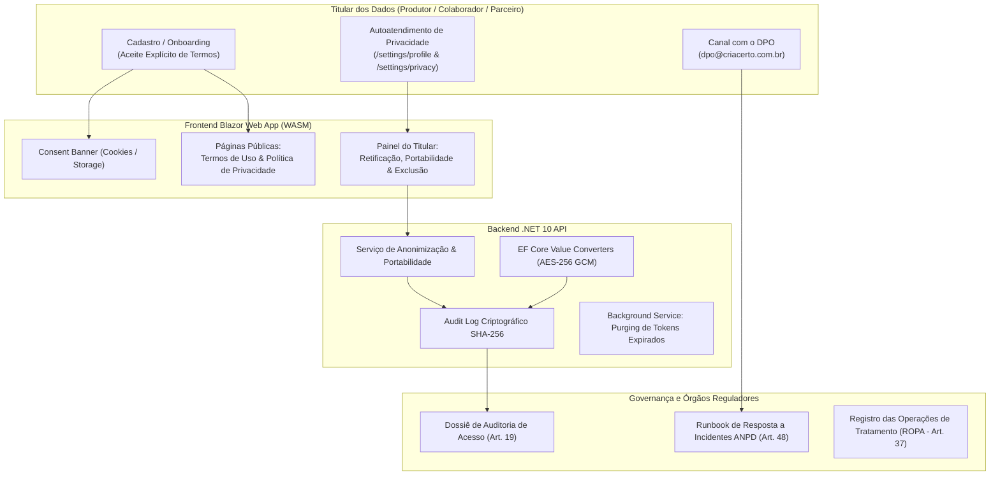

# Roadmap de Implementação: Adequação Plena à LGPD (Lei nº 13.709/2018)

## 1. Visão Geral e Enquadramento Legal

Este documento estabelece o plano executivo e técnico de adequação do ecossistema **CriaCerto** à **Lei Geral de Proteção de Dados Pessoais (LGPD - Lei Federal nº 13.709/2018)**.

O CriaCerto opera no modelo SaaS B2B Multi-tenant para produtores rurais, fazendas e parceiros comerciais de fomento pecuário. Sob as diretrizes da LGPD e as resoluções da **Autoridade Nacional de Proteção de Dados (ANPD)**, a plataforma assume dois papéis distintos:

1. **CriaCerto como Controlador de Dados**:
   - Dados cadastrais, contratuais, fiscais e de faturamento dos clientes contratantes (produtores rurais, pessoas físicas e jurídicas).
   - Credenciais de acesso e dados de perfil de usuários da plataforma (`User`).
   - Dados de parceiros comerciais participantes do Programa de Indicação (`CommercialPartnerProfile`, contratos com chaves Pix e CPF em `Referral`).
2. **CriaCerto como Operador de Dados (Processor)**:
   - Dados de terceiros e colaboradores da fazenda (veterinários, zootecnistas, operadores de curral) cadastrados pelos próprios produtores via convites de equipe (`TeamInvite`).
   - Nesse cenário, a fazenda contratante atua como **Controladora**, e o CriaCerto processa tais dados estritamente sob as instruções e finalidades do contrato SaaS.

### Estado Atual vs Objetivo
- **O que já está implementado (Backoffice & Referral - [ADR 0011](file:///home/rony/LPR/CriaCerto/docs/adrs/0011-lgpd-compliance-contextual-masking-and-access-governance.md))**:
  - Mascaramento contextual e dinâmico (`IPiiDataMasker` e `<MaskedDataField>` em Blazor).
  - Trilha forense encadeada com hash criptográfico SHA-256 (`AuditLog`).
  - Desmascaramento Just-In-Time com justificativa operacional obrigatória (`RevealSensitiveDataCommand`).
  - Dossiê formal de auditoria de acessos para fiscalizações (`ExportAccessTrailQuery`).
  - Mascaramento em indicações (`LgpdFarmNameMasker`).
- **Objetivo deste Roadmap**:
  - Implementar todas as regras faltantes para conformidade integral com foco nos **Direitos do Titular (Art. 18)**, **Consentimento e Políticas Públicas (Art. 7º, 8º e 9º)**, **Criptografia em Repouso**, **Ciclo de Retenção/Purging** e **Procedimentos de Notificação à ANPD (Art. 48)**.

---

## 2. Regra de Conclusão por Sub-fase (Definition of Done)

> **Uma sub-fase só é considerada CONCLUÍDA quando:**
> 1. O código de backend (.NET 10) aderir ao Clean Architecture, Result Pattern (`Result<T>`) e segregação modular de persistência.
> 2. As migrações do Entity Framework Core estiverem aplicadas e validadas contra o banco de dados.
> 3. As interfaces Blazor Web App (WASM) estiverem integradas às APIs, responsivas e alinhadas ao design system do CriaCerto.
> 4. Houver cobertura de testes unitários e de integração com xUnit e FluentAssertions para todos os fluxos críticos.
> 5. As regras de auditoria e logs respeitarem a minimização de dados sem vazamento de PII.
> 6. A documentação viva (`docs/`) e ADRs correlatas estiverem atualizadas.

---

## 3. Arquitetura da Governança de Dados Pessoais



---

## 4. Cronograma Geral das Fases de Implementação

```
┌────────────────────────────────────────────────────────────────────────┐
│ Fase 1: Transparência, Políticas Públicas e Registro de Consentimento  │
└───────────────────────────────────┬────────────────────────────────────┘
                                    │
┌───────────────────────────────────▼────────────────────────────────────┐
│ Fase 2: Portal de Direitos do Titular (Autoatendimento & Art. 18)      │
└───────────────────────────────────┬────────────────────────────────────┘
                                    │
┌───────────────────────────────────▼────────────────────────────────────┐
│ Fase 3: Segurança de Dados Sensíveis e Criptografia em Repouso         │
└───────────────────────────────────┬────────────────────────────────────┘
                                    │
┌───────────────────────────────────▼────────────────────────────────────┐
│ Fase 4: Ciclo de Retenção, Descarte e Relação B2B (DPA / Operador)     │
└───────────────────────────────────┬────────────────────────────────────┘
                                    │
┌───────────────────────────────────▼────────────────────────────────────┐
│ Fase 5: Governança do DPO, Runbook de Incidentes ANPD e ROPA           │
└────────────────────────────────────────────────────────────────────────┘
```

---

## 5. Detalhamento das Fases e Entregas

---

### Fase 1: Transparência, Políticas Públicas e Registro de Consentimento Auditável

O objetivo desta fase é instituir as bases legais de transparência ativa, publicar os documentos normativos do CriaCerto e armazenar evidências auditáveis de consentimento/aceite para cada usuário cadastrado.

#### 1.1 Páginas Públicas de Termos de Uso e Política de Privacidade
- [x] Criar página pública de **Termos de Uso** (`/termos-de-uso` ou `/terms`) em Blazor ([`TermsOfService.razor`](file:///home/rony/LPR/CriaCerto/src/Web/CriaCerto.Web/CriaCerto.Web.Client/Pages/Legal/TermsOfService.razor)):
  - Condições de prestação de serviços SaaS agropecuários.
  - Regras de licenciamento, responsabilidades pelas informações zootécnicas e SLA.
  - Definição do produtor como Controlador de dados de terceiros inseridos na granja.
- [x] Criar página pública de **Política de Privacidade** (`/politica-de-privacidade` ou `/privacidade`) em Blazor ([`PrivacyPolicy.razor`](file:///home/rony/LPR/CriaCerto/src/Web/CriaCerto.Web/CriaCerto.Web.Client/Pages/Legal/PrivacyPolicy.razor)):
  - Finalidades claras para cada dado coletado (cadastro, identificação de rebanho, geolocalização da fazenda, cobrança via Stripe, contato).
  - Bases legais aplicáveis (Execução de Contrato - Art. 7º, V; Cumprimento de Obrigação Legal/Fiscal - Art. 7º, II; Legítimo Interesse - Art. 7º, IX).
  - Lista de operadores e subprocessadores terceiros (Stripe para pagamentos, Resend para e-mails transacionais, provedores de cloud computing).
  - Prazos de retenção de dados e critérios de descarte.
  - Direitos dos titulares e identificação do canal do Encarregado (DPO) via ([`DpoContactCard.razor`](file:///home/rony/LPR/CriaCerto/src/Web/CriaCerto.Web/CriaCerto.Web.Client/Components/Legal/DpoContactCard.razor)).
- [x] Atualizar o rodapé institucional da Landing Page ([`Home.razor`](file:///home/rony/LPR/CriaCerto/src/Web/CriaCerto.Web/CriaCerto.Web.Client/Pages/Home.razor)) com links diretos para Termos de Uso, Política de Privacidade e Canal de Privacidade.
- [x] Atualizar a página de Registro ([`Register.razor`](file:///home/rony/LPR/CriaCerto/src/Web/CriaCerto.Web/CriaCerto.Web.Client/Pages/Register.razor)) com links clicáveis que abrem os termos em nova aba (`target="_blank"`).

#### 1.2 Rastreabilidade e Armazenamento Auditável do Consentimento
- [x] Evolução da entidade [`User`](file:///home/rony/LPR/CriaCerto/src/Modules/Tenancy/CriaCerto.Modules.Tenancy.Application/Domain/User.cs):
  - Adicionado campos:
    - `TermsAcceptedAtUtc` (DateTime?)
    - `PrivacyPolicyAcceptedAtUtc` (DateTime?)
    - `TermsVersion` (string, `"1.0"`)
    - `PrivacyPolicyVersion` (string, `"1.0"`)
    - `ConsentIpAddress` (string?, max 45 chars)
- [x] Atualizar o mapeamento no [`TenancyDbContext`](file:///home/rony/LPR/CriaCerto/src/Modules/Tenancy/CriaCerto.Modules.Tenancy.Infrastructure/Persistence/TenancyDbContext.cs) e gerar migração do EF Core no schema `tenancy` ([`20261026192711_AddUserConsentTrackingFields.cs`](file:///home/rony/LPR/CriaCerto/src/Modules/Tenancy/CriaCerto.Modules.Tenancy.Infrastructure/Persistence/Migrations/20261026192711_AddUserConsentTrackingFields.cs)).
- [x] Atualizar o comando [`RegisterUserCommand`](file:///home/rony/LPR/CriaCerto/src/Modules/Tenancy/CriaCerto.Modules.Tenancy.Application/Features/RegisterUser/RegisterUserCommand.cs):
  - Exigir aceite explícito (`AcceptTermsAndPrivacy: true`) validado via FluentValidation ([`RegisterUserCommandValidator.cs`](file:///home/rony/LPR/CriaCerto/src/Modules/Tenancy/CriaCerto.Modules.Tenancy.Application/Features/RegisterUser/RegisterUserCommandValidator.cs)).
  - Capturar o IP da requisição de forma limpa e desacoplada via [`IUserClientIpResolver`](file:///home/rony/LPR/CriaCerto/src/Modules/Tenancy/CriaCerto.Modules.Tenancy.Application/Abstractions/IUserClientIpResolver.cs) / [`HttpContextUserClientIpResolver`](file:///home/rony/LPR/CriaCerto/src/Host/CriaCerto.Api/Services/HttpContextUserClientIpResolver.cs) preservando compatibilidade com Blazor WebAssembly.
- [x] Atualizar [`Register.razor`](file:///home/rony/LPR/CriaCerto/src/Web/CriaCerto.Web/CriaCerto.Web.Client/Pages/Register.razor) para incluir checkbox obrigatório:
  - *"Li e concordo com os [Termos de Uso](/termos-de-uso) e a [Política de Privacidade](/politica-de-privacidade)*" com validação de formulário antes do submit.
- [x] Gravar evento de auditoria forense no cadastro (`Action = "USER_CONSENT_REGISTERED"`) via [`ITenancyAuditSink`](file:///home/rony/LPR/CriaCerto/src/Modules/Tenancy/CriaCerto.Modules.Tenancy.Application/Abstractions/ITenancyAuditSink.cs) e [`TenancyBackofficeAuditSink`](file:///home/rony/LPR/CriaCerto/src/Host/CriaCerto.Api/Services/TenancyBackofficeAuditSink.cs) com encadeamento de integridade SHA-256 e severidade High.

#### 1.3 Banner de Cookies e Armazenamento Local (PWA/Offline)
- [x] Criar componente atômico Blazor [`CookieConsentBanner.razor`](file:///home/rony/LPR/CriaCerto/src/Web/CriaCerto.Web/CriaCerto.Web.Client/Components/Legal/CookieConsentBanner.razor):
  - Informar de maneira clara o uso de cookies estritamente necessários (sessão de login), armazenamento local para modo off-line no curral (`localStorage` / IndexedDB) e cookie de atribuição de parceiro (`?ref=`).
  - Botão de confirmação *"Entendido e Continuar"* que persiste o aceite no `localStorage` sob a chave `cria_certo_cookie_consent_v1` com expiração de 180 dias gerenciado por [`ICookieConsentService`](file:///home/rony/LPR/CriaCerto/src/Web/CriaCerto.Web/CriaCerto.Web.Client/Services/CookieConsentService.cs) e [`CookieConsentModels.cs`](file:///home/rony/LPR/CriaCerto/src/Web/CriaCerto.Web/CriaCerto.Web.Client/Models/CookieConsentModels.cs).
  - Link de fácil acesso para a Política de Privacidade e painel sanfonado para detalhes técnicos das tecnologias de armazenamento.
- [x] Injetar o banner no layout principal ([`MainLayout.razor`](file:///home/rony/LPR/CriaCerto/src/Web/CriaCerto.Web/CriaCerto.Web.Client/Layout/MainLayout.razor)), nos layouts públicos ([`LegalLayout.razor`](file:///home/rony/LPR/CriaCerto/src/Web/CriaCerto.Web/CriaCerto.Web.Client/Layout/LegalLayout.razor), [`EmptyLayout.razor`](file:///home/rony/LPR/CriaCerto/src/Web/CriaCerto.Web/CriaCerto.Web.Client/Layout/EmptyLayout.razor)) e de parceiros ([`PartnerLayout.razor`](file:///home/rony/LPR/CriaCerto/src/Web/CriaCerto.Web/CriaCerto.Web.Client/Layout/PartnerLayout.razor)).


---

### Fase 2: Portal de Direitos do Titular (Autoatendimento & Art. 18 da LGPD)

O objetivo desta fase é assegurar que o titular dos dados (produtor ou colaborador da granja) possa exercer todos os direitos previstos no Art. 18 da LGPD de forma direta e transparente pelo sistema.

#### 2.1 Direito de Retificação e Gestão de Perfil Pessoal (Art. 18, III)
- [x] Criar comando e endpoint no módulo Tenancy:
  - `GET /api/v1/auth/profile` - Consulta dos dados cadastrais do próprio usuário logado (`FullName`, `Email`, `PhoneNumber`, `IsEmailConfirmed`, data de criação `CreatedAtUtc`, consentimentos e tenants vinculados) via [`GetUserProfileQuery.cs`](file:///home/rony/LPR/CriaCerto/src/Modules/Tenancy/CriaCerto.Modules.Tenancy.Application/Features/GetUserProfile/GetUserProfileQuery.cs).
  - `PUT /api/v1/auth/profile` - Atualização cadastral de `FullName` e `PhoneNumber` com validação de dados via [`UpdateUserProfileCommand.cs`](file:///home/rony/LPR/CriaCerto/src/Modules/Tenancy/CriaCerto.Modules.Tenancy.Application/Features/UpdateUserProfile/UpdateUserProfileCommand.cs) e [`UpdateUserProfileCommandValidator.cs`](file:///home/rony/LPR/CriaCerto/src/Modules/Tenancy/CriaCerto.Modules.Tenancy.Application/Features/UpdateUserProfile/UpdateUserProfileCommandValidator.cs), registrando auditoria forense SHA-256 (`USER_PROFILE_RECTIFIED`).
  - `POST /api/v1/auth/change-password` - Alteração autenticada de senha exigindo validação da senha atual em tempo constante via [`ChangeUserPasswordCommand.cs`](file:///home/rony/LPR/CriaCerto/src/Modules/Tenancy/CriaCerto.Modules.Tenancy.Application/Features/ChangeUserPassword/ChangeUserPasswordCommand.cs) e regras de entropia via [`ChangeUserPasswordCommandValidator.cs`](file:///home/rony/LPR/CriaCerto/src/Modules/Tenancy/CriaCerto.Modules.Tenancy.Application/Features/ChangeUserPassword/ChangeUserPasswordCommandValidator.cs), registrando auditoria forense (`USER_PASSWORD_CHANGED`).
  - Mapeamento e migração EF Core adicionando `CreatedAtUtc` em `User` via [`20261026210040_AddUserCreatedAtUtc.cs`](file:///home/rony/LPR/CriaCerto/src/Modules/Tenancy/CriaCerto.Modules.Tenancy.Infrastructure/Persistence/Migrations/20261026210040_AddUserCreatedAtUtc.cs).
- [x] Criar tela de autoatendimento no Blazor: `/settings/profile` (**Meu Perfil & Segurança**):
  - Interface Blazor Web App em [`ProfileManagement.razor`](file:///home/rony/LPR/CriaCerto/src/Web/CriaCerto.Web/CriaCerto.Web.Client/Pages/Settings/ProfileManagement.razor) com formulário de retificação de dados cadastrais.
  - Painel de alteração de senha com medidor interativo de força (*Password Strength Meter*) e checklist em tempo real.
  - Exibição transparente de granjas associadas, papéis exercidos (RBAC), planos e metadados de aceite dos Termos de Uso e Política de Privacidade.
  - Central de Privacidade & Encarregado (DPO) com links diretos institucionais.
  - Registro de item de menu em [`NavigationCatalog.cs`](file:///home/rony/LPR/CriaCerto/src/Web/CriaCerto.Web/CriaCerto.Web.Client/Models/NavigationItem.cs) e botão de acesso rápido ao perfil no cabeçalho em [`MainLayout.razor`](file:///home/rony/LPR/CriaCerto/src/Web/CriaCerto.Web/CriaCerto.Web.Client/Layout/MainLayout.razor).
  - Formalização arquitetural no [ADR 0017](file:///home/rony/LPR/CriaCerto/docs/adrs/0017-lgpd-data-subject-profile-rectification-and-security.md).

#### 2.2 Direito de Acesso e Portabilidade dos Dados Pessoais (Art. 18, II e V)
- [x] Criar query e endpoint de portabilidade:
  - `GET /api/v1/auth/my-data/export` implementado em [`Program.cs`](file:///home/rony/LPR/CriaCerto/src/Host/CriaCerto.Api/Program.cs).
  - Retorna um pacote estruturado em formato canônico interoperável (`JSON` RFC 8259 indentado) via [`ExportUserDataPortabilityQuery.cs`](file:///home/rony/LPR/CriaCerto/src/Modules/Tenancy/CriaCerto.Modules.Tenancy.Application/Features/ExportUserDataPortability/ExportUserDataPortabilityQuery.cs) contendo:
    - Dados cadastrais do usuário (`UserDataExportDto`).
    - Termos aceitos e carimbos de consentimento (`ConsentMetadataExportDto`).
    - Fazendas/Tenants vinculados e papéis desempenhados (`TenantAffiliationExportDto`).
    - Trilha resumida de acessos e ações do usuário (`UserAuditTrailEntryExportDto`) obtida via [`IUserAuditTrailLookupService.cs`](file:///home/rony/LPR/CriaCerto/src/Modules/Tenancy/CriaCerto.Modules.Tenancy.Application/Abstractions/IUserAuditTrailLookupService.cs).
- [x] Na tela `/settings/privacy` e `/settings/profile`, disponibilizar o Card e botão **"Exportar Meus Dados Pessoais (Portabilidade LGPD)"** com download automático no navegador em [`ProfileManagement.razor`](file:///home/rony/LPR/CriaCerto/src/Web/CriaCerto.Web/CriaCerto.Web.Client/Pages/Settings/ProfileManagement.razor) via [`TenancyApiClient.cs`](file:///home/rony/LPR/CriaCerto/src/Web/CriaCerto.Web/CriaCerto.Web.Client/Services/TenancyApiClient.cs) e link no menu [`NavigationItem.cs`](file:///home/rony/LPR/CriaCerto/src/Web/CriaCerto.Web/CriaCerto.Web.Client/Models/NavigationItem.cs).
- [x] Registrar evento de auditoria forense (`Action = "DATA_SUBJECT_PORTABILITY_EXPORTED"`, `Category = AuditCategory.Compliance`, `Severity = AuditSeverity.High`, hash SHA-256 encadeado) em [`TenancyBackofficeAuditSink.cs`](file:///home/rony/LPR/CriaCerto/src/Host/CriaCerto.Api/Services/TenancyBackofficeAuditSink.cs).
- [x] Formalização arquitetural no [ADR 0018](file:///home/rony/LPR/CriaCerto/docs/adrs/0018-lgpd-data-subject-access-and-portability.md).

#### 2.3 Direito de Eliminação, Encerramento de Conta e Anonimização (Art. 18, VI)
- [x] Definir a **Regra de Harmonização LGPD vs Obrigações Fiscais/Agropecuárias**:
  - Dados pessoais estritos do usuário (nome, telefone, credenciais) são eliminados e anonimizados com base no Art. 18, VI da LGPD.
  - Dados zootécnicos da fazenda (pesagens de lotes, inseminações, vacinas, partos, transferências) e transações de pagamento (Stripe) **devem ser preservados** por imperativo legal (Código Civil - 5 anos; normas sanitárias do MAPA / rastreabilidade animal).
  - **Mecanismo de Anonimização**:
    - Substituição de `FullName` por `"Titular Anonimizado"`.
    - Substituição de `Email` por hash irreversível `anon_{guid}@deleted.criacerto.com.br`.
    - Zeramento de `PhoneNumber`, `EmailConfirmationToken`, `PasswordResetToken` e sobrescrita de `PasswordHash` para `"ANONYMIZED_DISABLED_CREDENTIAL"`.
    - Marcação de `IsAnonymized = true` e `AnonymizedAtUtc = DateTime.UtcNow` via método `Anonymize` em [`User.cs`](file:///home/rony/LPR/CriaCerto/src/Modules/Tenancy/CriaCerto.Modules.Tenancy.Application/Domain/User.cs).
    - Desassociação de todos os vínculos em `UserTenant` via `_dbContext.UserTenants.RemoveRange`.
    - Migração EF Core adicionando `IsAnonymized`, `AnonymizedAtUtc` e `AnonymizationReason` via [`20261026220418_AddUserAnonymizationFields.cs`](file:///home/rony/LPR/CriaCerto/src/Modules/Tenancy/CriaCerto.Modules.Tenancy.Infrastructure/Persistence/Migrations/20261026220418_AddUserAnonymizationFields.cs).
- [x] Criar comando e endpoint `AnonymizeUserAccountCommand`:
  - `POST /api/v1/auth/account/delete` implementado em [`Program.cs`](file:///home/rony/LPR/CriaCerto/src/Host/CriaCerto.Api/Program.cs).
  - Execução autenticada via [`AnonymizeUserAccountCommand.cs`](file:///home/rony/LPR/CriaCerto/src/Modules/Tenancy/CriaCerto.Modules.Tenancy.Application/Features/AnonymizeUserAccount/AnonymizeUserAccountCommand.cs) com validação de senha atual em tempo constante e validação da palavra-chave `"EXCLUIR"` em [`AnonymizeUserAccountCommandValidator.cs`](file:///home/rony/LPR/CriaCerto/src/Modules/Tenancy/CriaCerto.Modules.Tenancy.Application/Features/AnonymizeUserAccount/AnonymizeUserAccountCommandValidator.cs).
  - **Salvaguarda de Administrador Único**: Se o usuário for o único Administrador ativo de um Tenant com plano vigente (`CanProducerAccess`), bloqueia a operação com `409 Conflict` e orienta transferência de titularidade ou cancelamento prévio em [`AnonymizeUserAccountCommandHandler.cs`](file:///home/rony/LPR/CriaCerto/src/Modules/Tenancy/CriaCerto.Modules.Tenancy.Application/Features/AnonymizeUserAccount/AnonymizeUserAccountCommandHandler.cs).
  - Registro de auditoria forense com severidade crítica (`Action = "USER_ACCOUNT_ANONYMIZED"`, `Category = AuditCategory.Compliance`, `Severity = AuditSeverity.Critical`, SHA-256 encadeado) em [`TenancyBackofficeAuditSink.cs`](file:///home/rony/LPR/CriaCerto/src/Host/CriaCerto.Api/Services/TenancyBackofficeAuditSink.cs).
- [x] Criar Card de Zona de Perigo e Modal de Confirmação com Duplo Aviso em Blazor:
  - Card **"Zona de Perigo: Eliminação de Conta & Anonimização"** e modal de confirmação com aviso detalhado da regra de harmonização em [`ProfileManagement.razor`](file:///home/rony/LPR/CriaCerto/src/Web/CriaCerto.Web/CriaCerto.Web.Client/Pages/Settings/ProfileManagement.razor).
  - Integração no cliente via [`TenancyApiClient.cs`](file:///home/rony/LPR/CriaCerto/src/Web/CriaCerto.Web/CriaCerto.Web.Client/Services/TenancyApiClient.cs) acionando `MarkUserAsLoggedOut()` e redirecionando para `/login?reason=account_deleted`.
  - Formalização arquitetural no [ADR 0019](file:///home/rony/LPR/CriaCerto/docs/adrs/0019-lgpd-data-subject-account-deletion-and-anonymization.md).

---

### Fase 3: Proteção de Dados Sensíveis e Criptografia em Repouso (Art. 46)

O objetivo desta fase é proteger dados financeiros e documentos pessoais em nível de persistência contra vazamento em dumps de banco de dados e garantir sanitização de logs.

#### 3.1 Criptografia em Repouso no Módulo de Indicações (`Referral`)
- [x] Identificar campos com PII sensível em `PartnerContract`:
  - `PixKey` (Chave Pix - pode ser CPF, telefone ou e-mail pessoal).
  - `LegalDocumentNumber` (CPF ou CNPJ do parceiro comercial).
  - Mapeamento e proteção com envelope Base64 autenticado `$cc1$` em [`PartnerContract.cs`](file:///home/rony/LPR/CriaCerto/src/Modules/Referral/CriaCerto.Modules.Referral.Application/Domain/PartnerContract.cs).
- [x] Implementar serviço de criptografia simétrica com rotação de chaves:
  - Abstração centralizada [`IDataEncryptionService.cs`](file:///home/rony/LPR/CriaCerto/src/BuildingBlocks/CriaCerto.BuildingBlocks.Abstractions/Security/IDataEncryptionService.cs) e opções [`EncryptionOptions.cs`](file:///home/rony/LPR/CriaCerto/src/BuildingBlocks/CriaCerto.BuildingBlocks.Abstractions/Security/EncryptionOptions.cs).
  - Implementação com algoritmo padrão **AES-256-GCM** e chaveiro de rotação de versões (`KeyRing`) em [`AesGcmDataEncryptionService.cs`](file:///home/rony/LPR/CriaCerto/src/BuildingBlocks/CriaCerto.BuildingBlocks.Infrastructure/Security/AesGcmDataEncryptionService.cs).
  - Padrão **Blind Indexing (HMAC-SHA256)** via `ComputeBlindIndex` para validação de unicidade $O(1)$ sem expor PII nos cadastros em [`RegisterCommercialPartnerCommand.cs`](file:///home/rony/LPR/CriaCerto/src/Modules/Referral/CriaCerto.Modules.Referral.Application/Features/CommercialPartners/Commands/RegisterCommercialPartnerCommand.cs).
- [x] Implementar EF Core Value Converter para encriptação transparente no schema `referral`:
  - [`EncryptedStringConverter.cs`](file:///home/rony/LPR/CriaCerto/src/BuildingBlocks/CriaCerto.BuildingBlocks.Infrastructure/Security/EncryptedStringConverter.cs) integrado no [`ReferralDbContext.cs`](file:///home/rony/LPR/CriaCerto/src/Modules/Referral/CriaCerto.Modules.Referral.Infrastructure/Persistence/ReferralDbContext.cs), interceptando leitura/escrita com colunas `PixKey` e `LegalDocumentNumber` expandidas para `nvarchar(512)` e coluna indexada `LegalDocumentNumberHash` (`nvarchar(64)`).
  - Migração EF Core gerada via [`20261026223606_Add_PartnerContract_Encryption_And_Blind_Index.cs`](file:///home/rony/LPR/CriaCerto/src/Modules/Referral/CriaCerto.Modules.Referral.Infrastructure/Persistence/Migrations/20261026223606_Add_PartnerContract_Encryption_And_Blind_Index.cs).
- [x] Criar script de migração e re-encriptação de dados existentes para ambientes legados:
  - Serviço de re-encriptação idempotente [`ReferralDataReencryptionService.cs`](file:///home/rony/LPR/CriaCerto/src/Modules/Referral/CriaCerto.Modules.Referral.Infrastructure/Services/ReferralDataReencryptionService.cs).
  - Endpoint administrativo autenticado `POST /api/v1/backoffice/referral/reencrypt-contracts` mapeado em [`Program.cs`](file:///home/rony/LPR/CriaCerto/src/Host/CriaCerto.Api/Program.cs).
  - Formalização arquitetural no [ADR 0020](file:///home/rony/LPR/CriaCerto/docs/adrs/0020-lgpd-referral-at-rest-encryption-and-blind-indexing.md).

#### 3.2 Sanitização e Prevenção de Vazamento de PII em Logs e Telemetria
- [x] Revisar configurações de log no ASP.NET Core e Serilog:
  - Integração do pacote `Serilog.AspNetCore` (10.0.0) com enriquecimento estruturado contextual (`Application`, `Environment`, `TraceId`) em [`Program.cs`](file:///home/rony/LPR/CriaCerto/src/Host/CriaCerto.Api/Program.cs).
  - Implementação de motor centralizado de redaction [`IPiiRedactor.cs`](file:///home/rony/LPR/CriaCerto/src/BuildingBlocks/CriaCerto.BuildingBlocks.Abstractions/Security/IPiiRedactor.cs) e [`PiiRedactor.cs`](file:///home/rony/LPR/CriaCerto/src/BuildingBlocks/CriaCerto.BuildingBlocks.Infrastructure/Security/PiiRedactor.cs).
  - Middleware de auditoria de requisições [`RequestLoggingMiddleware.cs`](file:///home/rony/LPR/CriaCerto/src/Host/CriaCerto.Api/Middleware/RequestLoggingMiddleware.cs) sanitizando cabeçalhos sensíveis (`Authorization: Bearer [REDACTED]`, `Cookie`, `Set-Cookie`, `X-Api-Key`), query strings e corpos JSON com supressão total (`[REDACTED_SENSITIVE_ENDPOINT]`) para credenciais de login, cartões e Pix.
  - Blindagem de traces OpenTelemetry no [`BackofficeObservabilityBehavior.cs`](file:///home/rony/LPR/CriaCerto/src/Modules/Backoffice/CriaCerto.Modules.Backoffice.Application/Telemetry/BackofficeObservabilityBehavior.cs), evitando injeção de connection strings e PII em tags de `ActivitySource`.
- [x] Assegurar que exceções não tratadas retornem payloads padronizados com `Result Pattern` (`Error.Unexpected`) e não exponham stack traces ou connection strings para o cliente HTTP:
  - Adicionado factory method `Error.Unexpected(string? traceId)` em [`Error.cs`](file:///home/rony/LPR/CriaCerto/src/BuildingBlocks/CriaCerto.BuildingBlocks.Abstractions/Results/Error.cs) e mapeamento HTTP 500 no `ToErrorStatusCode` em [`Program.cs`](file:///home/rony/LPR/CriaCerto/src/Host/CriaCerto.Api/Program.cs).
  - Implementação de [`GlobalExceptionHandlerMiddleware.cs`](file:///home/rony/LPR/CriaCerto/src/Host/CriaCerto.Api/Middleware/GlobalExceptionHandlerMiddleware.cs) como barreira externa do pipeline HTTP, registrando stack traces de forma segura no log interno e retornando payload JSON Result Pattern opaco ao cliente final.
  - Formalização arquitetural no [ADR 0021](file:///home/rony/LPR/CriaCerto/docs/adrs/0021-lgpd-pii-redaction-and-unhandled-exception-hardening.md).

---

### Fase 4: Ciclo de Retenção, Descarte e Relação B2B (DPA / Operador)

O objetivo desta fase é formalizar a relação contratual SaaS e implementar rotinas automáticas de expurgo de dados temporários expirados.

#### 4.1 Aditivo de Processamento de Dados (DPA - Data Processing Agreement)
- [x] Redigir e publicar o **Termo de Processamento de Dados Pessoais (DPA)** como anexo aos Termos de Serviço:
  - Estabelece as obrigações do CriaCerto como Operador no tratamento dos dados dos colaboradores convidados pela granja (`TeamInvite`).
  - Obrigações de confidencialidade, salvaguardas técnicas (AES-256-GCM, blind indexing, isolamento multi-tenant, SHA-256), auxílio ao produtor no atendimento aos seus funcionários (Art. 18) e descarte após rescisão contratual.
  - Cláusula de governança de subprocessadores (Stripe, Resend, Cloud), auditoria e notificação ágil de incidentes de segurança (Art. 48) entre Controlador (Fazenda) e Operador (CriaCerto).
  - Publicação de página interativa [`DataProcessingAgreement.razor`](file:///home/rony/LPR/CriaCerto/src/Web/CriaCerto.Web/CriaCerto.Web.Client/Pages/Legal/DataProcessingAgreement.razor) sob `/dpa` e `/aditivo-processamento-dados`, integrada ao catálogo centralizado em [`LegalModels.cs`](file:///home/rony/LPR/CriaCerto/src/Web/CriaCerto.Web/CriaCerto.Web.Client/Models/LegalModels.cs), links no layout [`LegalLayout.razor`](file:///home/rony/LPR/CriaCerto/src/Web/CriaCerto.Web/CriaCerto.Web.Client/Layout/LegalLayout.razor), referências cruzadas em [`TermsOfService.razor`](file:///home/rony/LPR/CriaCerto/src/Web/CriaCerto.Web/CriaCerto.Web.Client/Pages/Legal/TermsOfService.razor) e consentimento em [`Register.razor`](file:///home/rony/LPR/CriaCerto/src/Web/CriaCerto.Web/CriaCerto.Web.Client/Pages/Register.razor).
  - Formalização arquitetural e jurídica no [ADR 0022](file:///home/rony/LPR/CriaCerto/docs/adrs/0022-lgpd-b2b-data-processing-agreement-dpa.md) e suíte de testes em [`LegalPagesTests.cs`](file:///home/rony/LPR/CriaCerto/tests/Unit/CriaCerto.Web.Client.UnitTests/Legal/LegalPagesTests.cs).

#### 4.2 Background Service para Expurgo de Tokens e Convites Expirados (Data Purging)
- [x] Criar serviço em segundo plano `DataRetentionPurgingBackgroundService` em `src/Host/CriaCerto.Api/BackgroundServices`:
  - Execução programada periódica (24h) baseada em `PeriodicTimer` com atraso inicial e suporte a encerramento gracioso em [`DataRetentionPurgingBackgroundService.cs`](file:///home/rony/LPR/CriaCerto/src/Host/CriaCerto.Api/BackgroundServices/DataRetentionPurgingBackgroundService.cs) e opções em [`DataRetentionPurgingOptions.cs`](file:///home/rony/LPR/CriaCerto/src/Host/CriaCerto.Api/Configuration/DataRetentionPurgingOptions.cs).
  - **Tokens de Autenticação**: Limpeza atômica de `PasswordResetToken` e `EmailConfirmationToken` expirados há mais de 7 dias através do método de domínio `ClearExpiredTokens()` em [`User.cs`](file:///home/rony/LPR/CriaCerto/src/Modules/Tenancy/CriaCerto.Modules.Tenancy.Application/Domain/User.cs) orquestrado pelo comando CQRS [`PurgeExpiredTenancyTokensAndInvitesCommand.cs`](file:///home/rony/LPR/CriaCerto/src/Modules/Tenancy/CriaCerto.Modules.Tenancy.Application/Features/DataRetention/PurgeExpiredTenancyTokensAndInvitesCommand.cs).
  - **Convites de Equipe (`TeamInvites`)**:
    - Identificação e expurgo físico seguro de convites não aceitos (`!IsAccepted`) expirados há mais de 30 dias em [`PurgeExpiredTenancyTokensAndInvitesCommandHandler.cs`](file:///home/rony/LPR/CriaCerto/src/Modules/Tenancy/CriaCerto.Modules.Tenancy.Application/Features/DataRetention/PurgeExpiredTenancyTokensAndInvitesCommandHandler.cs).
  - **Sessões Administrativas Expiradas**:
    - Expurgo seguro de sessões administrativas revogadas e refresh tokens expirados há mais de 7 dias no schema `backoffice` via [`PurgeExpiredAdminSessionsCommand.cs`](file:///home/rony/LPR/CriaCerto/src/Modules/Backoffice/CriaCerto.Modules.Backoffice.Application/Features/DataRetention/Commands/PurgeExpiredAdminSessionsCommand.cs) e [`PurgeExpiredAdminSessionsCommandHandler.cs`](file:///home/rony/LPR/CriaCerto/src/Modules/Backoffice/CriaCerto.Modules.Backoffice.Application/Features/DataRetention/Commands/PurgeExpiredAdminSessionsCommandHandler.cs).
- [x] Registrar métrica de auditoria com a contagem de registros expurgados no `AuditLog`:
  - Registro forense automático no `AuditLog` (`Action = "ADMIN_SESSIONS_PURGED"`, `Category = AuditCategory.Compliance`, `Severity = AuditSeverity.Low`, encadeamento criptográfico SHA-256 e payload estruturado `DetailsJson`).
  - Endpoint manual para disparo e testes ad-hoc `POST /api/v1/backoffice/compliance/data-retention/run-purge` em [`Program.cs`](file:///home/rony/LPR/CriaCerto/src/Host/CriaCerto.Api/Program.cs).
  - Formalização arquitetural no [ADR 0023](file:///home/rony/LPR/CriaCerto/docs/adrs/0023-lgpd-automated-data-purging-and-retention.md) e cobertura de testes em [`UserDomainTests.cs`](file:///home/rony/LPR/CriaCerto/tests/Unit/CriaCerto.Modules.Tenancy.UnitTests/Domain/UserDomainTests.cs), [`PurgeExpiredTenancyTokensAndInvitesCommandHandlerTests.cs`](file:///home/rony/LPR/CriaCerto/tests/Unit/CriaCerto.Modules.Tenancy.UnitTests/PurgeExpiredTenancyTokensAndInvitesCommandHandlerTests.cs), [`PurgeExpiredAdminSessionsCommandHandlerTests.cs`](file:///home/rony/LPR/CriaCerto/tests/Unit/CriaCerto.Modules.Backoffice.UnitTests/Features/PurgeExpiredAdminSessionsCommandHandlerTests.cs) e [`DataRetentionPurgingWorkerIntegrationTests.cs`](file:///home/rony/LPR/CriaCerto/tests/Integration/CriaCerto.Architecture.IntegrationTests/DataRetentionPurgingWorkerIntegrationTests.cs).

---

### Fase 5: Governança do DPO, Runbook de Incidentes ANPD e ROPA

O objetivo desta fase é cumprir os requisitos de governança institucional exigidos pelos artigos 37, 41 e 48 da LGPD.

#### 5.1 Canal Oficial de Comunicação do Encarregado (DPO - Art. 41)
- [x] Divulgar a identidade e canal de contato do DPO na Política de Privacidade e na página institucional:
  - E-mail dedicado: `privacidade@criacerto.com.br` / `dpo@criacerto.com.br`.
  - Prazo formal de resposta às solicitações dos titulares (15 dias úteis, conforme estipulado pelo Art. 19, II da LGPD).
  - Publicação do portal institucional dedicado [`DpoPortal.razor`](file:///home/rony/LPR/CriaCerto/src/Web/CriaCerto.Web/CriaCerto.Web.Client/Pages/Legal/DpoPortal.razor) sob as rotas `/dpo` e `/privacidade/canal-dpo`, estruturado com catálogo em [`LegalModels.cs`](file:///home/rony/LPR/CriaCerto/src/Web/CriaCerto.Web/CriaCerto.Web.Client/Models/LegalModels.cs), links no layout [`LegalLayout.razor`](file:///home/rony/LPR/CriaCerto/src/Web/CriaCerto.Web/CriaCerto.Web.Client/Layout/LegalLayout.razor) e rodapé em [`Home.razor`](file:///home/rony/LPR/CriaCerto/src/Web/CriaCerto.Web/CriaCerto.Web.Client/Pages/Home.razor).
- [x] Criar formulário e fluxo eletrônico oficial para recebimento e protocolo de solicitações de titulares (DSR):
  - Componente reativo [`DataSubjectRequestForm.razor`](file:///home/rony/LPR/CriaCerto/src/Web/CriaCerto.Web/CriaCerto.Web.Client/Components/Legal/DataSubjectRequestForm.razor) integrado ao portal do DPO e link de acesso rápido na central de configurações do produtor em [`ProfileManagement.razor`](file:///home/rony/LPR/CriaCerto/src/Web/CriaCerto.Web/CriaCerto.Web.Client/Pages/Settings/ProfileManagement.razor).
  - Endpoint REST `POST /api/v1/compliance/dpo/requests` em [`Program.cs`](file:///home/rony/LPR/CriaCerto/src/Host/CriaCerto.Api/Program.cs).
  - Comando CQRS [`SubmitDataSubjectRequestCommand.cs`](file:///home/rony/LPR/CriaCerto/src/Modules/Tenancy/CriaCerto.Modules.Tenancy.Application/Features/Compliance/Dpo/SubmitDataSubjectRequestCommand.cs), validador fluente [`SubmitDataSubjectRequestCommandValidator.cs`](file:///home/rony/LPR/CriaCerto/src/Modules/Tenancy/CriaCerto.Modules.Tenancy.Application/Features/Compliance/Dpo/SubmitDataSubjectRequestCommandValidator.cs) e handler [`SubmitDataSubjectRequestCommandHandler.cs`](file:///home/rony/LPR/CriaCerto/src/Modules/Tenancy/CriaCerto.Modules.Tenancy.Application/Features/Compliance/Dpo/SubmitDataSubjectRequestCommandHandler.cs).
  - Geração automática de protocolo oficial (`DSR-YYYYMMDD-XXXX`), cálculo de 15 dias úteis de prazo legal e despacho duplo de e-mail transacional via Resend (`IEmailSender`).
  - Registro de auditoria forense com severidade média (`Category = AuditCategory.Compliance, Action = "DATA_SUBJECT_REQUEST_SUBMITTED"`, SHA-256 encadeado) em [`TenancyBackofficeAuditSink.cs`](file:///home/rony/LPR/CriaCerto/src/Host/CriaCerto.Api/Services/TenancyBackofficeAuditSink.cs).
  - Formalização arquitetural no [ADR 0024](file:///home/rony/LPR/CriaCerto/docs/adrs/0024-lgpd-dpo-communication-channel-and-dsr-workflow.md) e cobertura de testes em [`SubmitDataSubjectRequestCommandValidatorTests.cs`](file:///home/rony/LPR/CriaCerto/tests/Unit/CriaCerto.Modules.Tenancy.UnitTests/SubmitDataSubjectRequestCommandValidatorTests.cs), [`SubmitDataSubjectRequestCommandHandlerTests.cs`](file:///home/rony/LPR/CriaCerto/tests/Unit/CriaCerto.Modules.Tenancy.UnitTests/SubmitDataSubjectRequestCommandHandlerTests.cs), [`UserProfileAndSecurityAuditIntegrationTests.cs`](file:///home/rony/LPR/CriaCerto/tests/Integration/CriaCerto.Architecture.IntegrationTests/UserProfileAndSecurityAuditIntegrationTests.cs) e [`LegalPagesTests.cs`](file:///home/rony/LPR/CriaCerto/tests/Unit/CriaCerto.Web.Client.UnitTests/Legal/LegalPagesTests.cs).

#### 5.2 Elaboração do RUNBOOK-07: Resposta a Incidentes de Vazamento de Dados Pessoais (Art. 48)
- [ ] Adicionar ao documento [`docs/operations/runbook_incident_response.md`](file:///home/rony/LPR/CriaCerto/docs/operations/runbook_incident_response.md) o procedimento operacional padrão **RUNBOOK-07: Gestão e Notificação de Incidente de Segurança com Dados Pessoais**:
  - Critérios de classificação de risco e dano relevante aos titulares.
  - Prazos de comunicação: notificação à ANPD e aos titulares afetados em até 3 dias úteis a contar do conhecimento do incidente (segundo as resoluções vigentes da ANPD).
  - Template canônico do relatório de notificação preliminar à ANPD (identificação dos dados vazados, titulares afetados, medidas de contenção adotadas e canal de contato do DPO).

#### 5.3 Formalização do Inventário de Dados (ROPA - Art. 37) e RIPD
- [ ] Criar documento em `docs/compliance/ropa_data_inventory.md`:
  - **ROPA (Record of Processing Activities)**: Mapeamento detalhado de cada processo de tratamento do CriaCerto (Cadastro, Faturamento, Operação do Rebanho, Suporte Assistido, Programa de Afiliados), com bases legais, categorias de dados, operadores envolvidos e prazos de retenção.
- [ ] Criar documento em `docs/compliance/ripd_dpia_overview.md`:
  - **RIPD (Relatório de Impacto à Proteção de Dados Pessoais)** avaliando os riscos inerentes à funcionalidade de impersonação de suporte e processamento financeiro com Stripe, atestando as medidas mitigadoras existentes (dupla salvaguarda, hash SHA-256 e Kill-Switch).

---

## 6. Matriz de Rastreabilidade e Cobertura de Testes

Para assegurar que as implementações não sofram regressão, a seguinte suíte de testes deve ser mantida:

```text
tests/
|-- Unit/
|   |-- CriaCerto.Modules.Tenancy.UnitTests/
|   |   |-- Domain/UserConsentTests.cs                 -> Valida gravação de versão e timestamp de termos
|   |   |-- Features/RegisterUserValidationTests.cs    -> Valida rejeição sem aceite de termos
|   |   |-- Features/AnonymizeUserTests.cs             -> Valida pseudonimização sem quebra de integridade
|   |   `-- Features/ExportPersonalDataTests.cs        -> Valida montagem do JSON de portabilidade
|   |-- CriaCerto.Modules.Referral.UnitTests/
|   |   `-- Security/EncryptedPixKeyConverterTests.cs  -> Valida cifra e decifra AES-256 no banco
|   `-- CriaCerto.Host.Api.UnitTests/
|       `-- BackgroundServices/PurgingServiceTests.cs  -> Valida limpeza de tokens e convites órfãos
`-- Integration/
    `-- CriaCerto.Architecture.IntegrationTests/
        |-- UserDataPortabilityIntegrationTests.cs     -> Valida download de dados do titular
        `-- UserAnonymizationIntegrationTests.cs       -> Valida encerramento seguro e preservação da granja
```

---

## 7. Critérios de Sucesso e Conformidade Final

Ao término da execução deste roadmap:
1. O CriaCerto possuirá **100% de conformidade técnica e jurídica** com os 10 princípios e o catálogo de direitos dos titulares da LGPD.
2. Todo usuário cadastrado terá **registro histórico imutável** de qual versão dos Termos e da Política de Privacidade aceitou.
3. Produtores e colaboradores poderão exercer seus direitos de **retificação, portabilidade e anonimização** com autoatendimento seguro.
4. Dados sensíveis financeiros estarão **cifrados em repouso**, e o sistema de purga manterá o banco limpo de dados temporários expirados.
5. A empresa estará plenamente documentada com **ROPA, RIPD, DPA e Runbook de Notificação à ANPD**, apta a responder a qualquer fiscalização ou auditoria externa (ISO 27701 / SOC 2).
