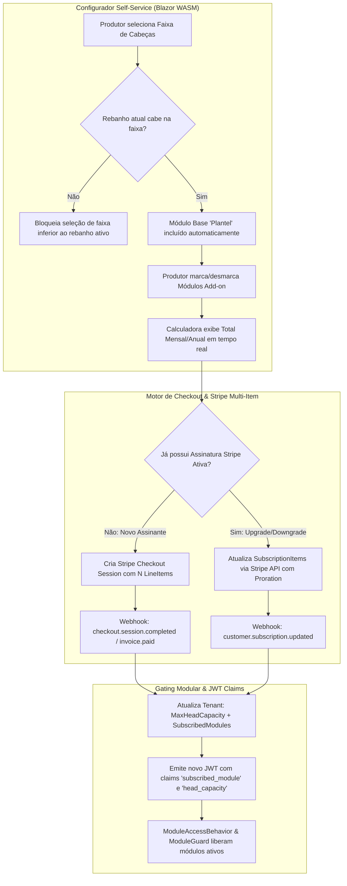

# Roadmap de Implementação: Assinatura Self-Service Modular & Precificação por Faixas de Cabeças

## 1. Visão Geral e Estratégia de Negócio

Este documento define o plano técnico e arquitetural para migrar o modelo comercial do **CriaCerto** — substituindo integralmente os pacotes engessados (`Starter`, `Pro` e `Enterprise`) por um motor de **Assinatura Self-Service Modular (À La Carte)** com **Precificação Escalonada por Faixas de Cabeças (*Tiered Pricing*)**.

### 1.1. Premissas Definitivas do Modelo Comercial
1. **Substituição Total dos Planos Fixos:** Os planos `Starter`, `Pro` e `Enterprise` deixam de existir para novas contratações e renovações, sendo substituídos por uma assinatura dinâmica baseada na combinação de **Faixa de Cabeças + Módulos Escolhidos**.
2. **Módulo Base Obrigatório (`Plantel` / `Cows`):**
   - Todo cliente contrata obrigatoriamente o **Módulo Base de Plantel** (gestão cadastral do rebanho, lotes básicos, unidades produtivas e dashboard executivo).
   - O preço do Módulo Base e de todos os módulos adicionais varia conforme a faixa de cabeças selecionada.
3. **Módulos Opcionais (Add-ons Self-Service):**
   - O produtor pode ativar ou desativar livremente qualquer combinação dos módulos especializados:
     - **`Breeding`** (Reprodução, IATF & Diagnóstico de Gestação)
     - **`Calving`** (Maternidade, Partos, Bezerreiro & Desmama)
     - **`Growth`** (Recria, Engorda, Pesagens, GPD & Pastagens/Lotação UA/ha)
     - **`Sanitary`** (Manejo Sanitário, Vacinas, Tratamentos & Bloqueio de Carência)
     - **`Nutrition`** (Nutrição, Silos, Trato TMR, Suplementação & Custo por @)
     - **`Analytics`** (Relatórios Avançados, Inteligência Zootécnica & BI)
4. **Faixas de Capacidade de Cabeças (*Head Tiers*):**
   - **Faixa 1 (`TIER_500`):** Até 500 cabeças
   - **Faixa 2 (`TIER_1500`):** De 501 a 1.500 cabeças
   - **Faixa 3 (`TIER_3000`):** De 1.501 a 3.000 cabeças
   - **Faixa 4 (`TIER_5000_PLUS`):** Acima de 3.000 cabeças (limite padrão 10.000+ cabeças)

---

## 2. Regra de Conclusão por Fase (Definition of Done)

> **Uma fase só é considerada CONCLUÍDA quando:**
> 1. O código de backend (.NET 10) seguir Clean Architecture, Result Pattern (`Result<T>`) e isolamento modular.
> 2. As migrações do Entity Framework Core estiverem geradas e aplicadas nos contextos `BackofficeDbContext` e `TenancyDbContext`.
> 3. O pipeline de autorização (`ModuleAccessBehavior` e `ModuleLicenseChecker`) validar a lista real de módulos contratados no JWT e no banco.
> 4. A integração com o Stripe suportar múltiplos itens (`SubscriptionItems`) na mesma assinatura e atualização proporcional (*proration*).
> 5. As telas em Blazor WASM (`SubscriptionManagement.razor`, `OnboardingWizard.razor`, `ModuleGuard.razor` e Backoffice) estiverem atualizadas e funcionais.
> 6. Todos os testes unitários e de integração passarem com cobertura dos novos fluxos.

---

## 3. Matriz Exemplificativa de Precificação por Faixa e Módulo

| Módulo | Código (`ModuleKey`) | Tipo | Até 500 cab. (`TIER_500`) | 501 a 1.500 cab. (`TIER_1500`) | 1.501 a 3.000 cab. (`TIER_3000`) | +3.000 cab. (`TIER_5000_PLUS`) |
| :--- | :--- | :---: | :---: | :---: | :---: | :---: |
| **Gestão do Plantel (Base)** | `Cows` | **Obrigatório** | R$ 79/mês | R$ 139/mês | R$ 219/mês | R$ 349/mês |
| **Reprodução & IATF** | `Breeding` | Opcional | + R$ 49/mês | + R$ 89/mês | + R$ 139/mês | + R$ 199/mês |
| **Maternidade & Bezerreiro** | `Calving` | Opcional | + R$ 39/mês | + R$ 69/mês | + R$ 109/mês | + R$ 159/mês |
| **Recria, Engorda & Pastos** | `Growth` | Opcional | + R$ 59/mês | + R$ 99/mês | + R$ 159/mês | + R$ 229/mês |
| **Sanitário & Carência** | `Sanitary` | Opcional | + R$ 49/mês | + R$ 89/mês | + R$ 139/mês | + R$ 199/mês |
| **Nutrição & Confinamento** | `Nutrition` | Opcional | + R$ 79/mês | + R$ 149/mês | + R$ 239/mês | + R$ 349/mês |
| **BI & Analytics Avançado** | `Analytics` | Opcional | + R$ 49/mês | + R$ 79/mês | + R$ 129/mês | + R$ 189/mês |

*(Valores configuráveis e versionáveis pelo Backoffice Administrativo; desconto percentual configurável para ciclo Anual).*

---

## 4. Arquitetura da Solução e Fluxo de Dados



---

## 5. Visão Geral das Fases de Implementação

```
┌──────────────────────────────────────────────────────────────────────────┐
│ Fase 1: Catálogo Modular e Tabelas de Faixas no Backoffice & Domínio     │
└────────────────────────────────────┬─────────────────────────────────────┘
                                     │
┌────────────────────────────────────▼─────────────────────────────────────┐
│ Fase 2: Refatoração do Motor de Licenciamento, Gating e Token JWT        │
└────────────────────────────────────┬─────────────────────────────────────┘
                                     │
┌────────────────────────────────────▼─────────────────────────────────────┐
│ Fase 3: Integração Stripe Multi-Item, Proration e Webhooks               │
└────────────────────────────────────┬─────────────────────────────────────┘
                                     │
┌────────────────────────────────────▼─────────────────────────────────────┐
│ Fase 4: Configurador Self-Service ("Monte seu Plano") e Compra 1-Clique  │
└────────────────────────────────────┬─────────────────────────────────────┘
                                     │
┌────────────────────────────────────▼─────────────────────────────────────┐
│ Fase 5: Adaptação do Programa de Indicação (Referral) & Ciclo de Vida    │
└────────────────────────────────────┬─────────────────────────────────────┘
                                     │
┌────────────────────────────────────▼─────────────────────────────────────┐
│ Fase 6: Migração de Dados, Testes Automatizados (TDD) e Documentação     │
└──────────────────────────────────────────────────────────────────────────┘
```

---

## 6. Detalhamento Técnico das Fases

---

### Fase 1: Catálogo Modular e Tabelas de Faixas no Backoffice & Domínio

Substituir a estrutura de planos monolíticos (`Starter/Pro/Enterprise`) por um catálogo de módulos independentes precificados por faixa de cabeças.

#### 1.1. Modelagem no `Modules.Backoffice`
* **Novas Entidades de Catálogo:**
  * `HeadTierCatalog`: Define as faixas comerciais disponíveis:
    * `Id`, `TierCode` (`TIER_500`, `TIER_1500`, `TIER_3000`, `TIER_5000_PLUS`), `DisplayName`, `MinHeads`, `MaxHeads`, `SortOrder`, `IsActive`.
  * `ModuleCatalog`: Define cada módulo comercializável:
    * `Id`, `ModuleKey` (`Cows`, `Breeding`, `Calving`, `Growth`, `Sanitary`, `Nutrition`, `Analytics`), `Name`, `Description`, `Icon`, `IsCore` (`true` apenas para `Cows`/`Plantel`), `IsActive`, `SortOrder`.
  * `ModuleTierPrice` (Versionado): Relaciona `ModuleCatalog` + `HeadTierCatalog`:
    * `Id`, `ModuleCatalogId`, `HeadTierCatalogId`, `VersionNumber`, `Status` (`Draft`, `Published`, `Deprecated`), `MonthlyPrice`, `AnnualPriceMonthly`, `StripePriceIdMonthly`, `StripePriceIdAnnual`.
* **Comandos e Queries do Backoffice:**
  * Endpoints em `/api/v1/backoffice/catalog/modules` e `/api/v1/backoffice/catalog/tiers` para gestão de preços por faixa e publicação imutável de versões.
  * Seed inicial (`BackofficeDbContextSeed`) populando as 4 faixas sugeridas e os 7 módulos (1 base + 6 opcionais).

#### 1.2. Modelagem no `Modules.Tenancy`
* **Atualização da Entidade `Tenant` e `TenantSubscription`:**
  * Adicionar propriedade `HeadTierCode` (`string`, padrão `"TIER_500"` no Trial) e manter `Capacity` sincronizado com o `MaxHeads` da faixa contratada.
  * Criar entidade/coleção `TenantSubscribedModule` (`TenantId`, `ModuleKey`, `StripeSubscriptionItemId`, `ActivatedAtUtc`, `MonthlyPriceSnapshot`).
  * No `CreateTenantCommand` (Onboarding / Trial de 30 dias):
    * O tenant inicia com `Status = "Trial"`, faixa `TIER_500` (`Capacity = 500`) e todos os módulos habilitados em degustação (ou os módulos escolhidos no wizard) durante os 30 dias de teste.
* **Arquivos Impactados:**
  - `src/Modules/Backoffice/CriaCerto.Modules.Backoffice.Application/Domain/Entities/*`
  - `src/Modules/Backoffice/CriaCerto.Modules.Backoffice.Infrastructure/Services/BackofficeSubscriptionPlansProvider.cs`
  - `src/Modules/Tenancy/CriaCerto.Modules.Tenancy.Application/Domain/Tenant.cs`
  - `src/Modules/Tenancy/CriaCerto.Modules.Tenancy.Application/Domain/TenantSubscription.cs`

---

### Fase 2: Refatoração do Motor de Licenciamento, Gating e Token JWT

Desacoplar a autorização de módulos da antiga string `SubscribedPlan` e passar a validar diretamente os módulos contratados e a faixa de cabeças ativa.

#### 2.1. Evolução do `ITenantContext` e Geração de JWT
* **Claims no Token JWT (`JwtTokenGenerator`):**
  * Substituir a dependência exclusiva de `subscribed_plan` pela inclusão de:
    * Múltiplas claims `subscribed_module` (ex.: `["Cows", "Breeding", "Sanitary"]`) ou claim compacta `subscribed_modules` (CSV/JSON).
    * Claim `head_tier` (`TIER_500`, `TIER_1500`, etc.) e `head_capacity` (`500`, `1500`, etc.).
* **Atualização de `ITenantContext` (`BuildingBlocks.Abstractions`):**
  * Adicionar `IReadOnlySet<string> SubscribedModules { get; }` e `int HeadCapacity { get; }`.

#### 2.2. Refatoração de `ModuleLicenseChecker` e `ModuleAccessBehavior`
* **`ModuleLicenseChecker`:**
  * Novo método principal: `HasModuleAccess(IEnumerable<string> subscribedModules, string requiredModule)`.
  * O módulo `"Cows"` (Plantel) e `"Tenancy"` são sempre permitidos para qualquer tenant ativo/em trial.
  * Remover o dicionário estático `PlanAccess` (`Starter`, `Pro`, `Enterprise`).
* **`ModuleAccessBehavior` (MediatR Pipeline):**
  * Ler `_tenantContext.SubscribedModules` e validar contra `[RequiresModule("...")]`.
  * Retornar erro padronizado `License.ModuleNotSubscribed` indicando exatamente qual módulo precisa ser adicionado à assinatura.
* ** Separação entre `Cows` (Plantel Base) e `Breeding` (IATF/DG):**
  * Garantir que os comandos/queries básicos de cadastro de animal (`CreateCow`, `GetPlantel`, `UpdateCow`, `Lots`) exijam `[RequiresModule("Cows")]` (módulo base), enquanto protocolos de IATF, Inseminação e Diagnóstico de Gestação exijam `[RequiresModule("Breeding")]`.
* **`PlanCapacityLimits` → `HeadTierCapacityLimits`:**
  * Validar o limite de animais cadastrados consultando diretamente `tenant.Capacity` da faixa contratada (500, 1.500, 3.000, 10.000+).
* **Arquivos Impactados:**
  - `src/BuildingBlocks/CriaCerto.BuildingBlocks.Abstractions/Tenancy/ITenantContext.cs`
  - `src/BuildingBlocks/CriaCerto.BuildingBlocks.Abstractions/Licensing/ModuleLicenseChecker.cs`
  - `src/BuildingBlocks/CriaCerto.BuildingBlocks.Application/Behaviors/ModuleAccessBehavior.cs`
  - `src/Modules/Tenancy/CriaCerto.Modules.Tenancy.Infrastructure/Auth/JwtTokenGenerator.cs`
  - `src/Modules/Tenancy/CriaCerto.Modules.Tenancy.Application/Domain/PlanCapacityLimits.cs`

---

### Fase 3: Integração Stripe Multi-Item, Proration e Webhooks

Adaptar o serviço de pagamentos para criar e atualizar assinaturas compostas por múltiplos itens (1 item para o Plantel na faixa X + N itens para os módulos adicionais na faixa X).

#### 3.1. Checkout de Nova Assinatura (`CreateCheckoutSessionCommand`) [x]
* **Novo Contrato de Request:**
  ```csharp
  public sealed record CreateCheckoutSessionRequest(
      Guid TenantId,
      string HeadTierCode,              // ex: "TIER_1500"
      List<string> SelectedModules,     // ex: ["Cows", "Breeding", "Sanitary"]
      string BillingCycle = "monthly",  // "monthly" | "annual"
      string? SuccessUrl = null,
      string? CancelUrl = null
  );
  ```
* **Regras de Negócio no Handler:**
  * Garantir que o módulo `"Cows"` (Plantel) esteja sempre incluído na lista.
  * Validar se a quantidade atual de cabeças ativas da fazenda (`currentHeadCount`) é menor ou igual ao `MaxHeads` da `HeadTierCode` escolhida via `ITenantActiveHerdCounter`. Se a fazenda tiver 700 cabeças, impedir a contratação da `TIER_500` retornando `License.HeadCapacityExceeded`.
  * Montar a lista de `SessionLineItemOptions` no Stripe (cada módulo selecionado entra como um item da assinatura com o preço correspondente àquela faixa e ciclo).
  * Gravar nos `Metadata` da Subscription e da Session:
    * `tenant_id`: `tenant.Id`
    * `head_tier`: `TIER_1500`
    * `max_heads`: `1500`
    * `subscribed_modules`: `"Cows,Breeding,Sanitary"`
    * `PlanId` e `BillingCycle` para retrocompatibilidade.
* **Implementação Concluída:**
  - Abstração desacoplada `ITenantActiveHerdCounter` em `Tenancy.Application.Abstractions`, com implementação base `DefaultTenantActiveHerdCounter` e implementação composta no Host `CompositeActiveHerdCounter`.
  - Suporte a multi-item e metadata canônica no `IStripePaymentService.CreateModularCheckoutSessionAsync` e `StripePaymentService`.
  - Bateria de testes de unidade cobrindo inclusão compulsória de `"Cows"`, teto de cabeças por faixa, montagem de itens, precificação anual e rejeição de faixas/módulos inválidos em `SubscriptionBillingAuthorizationTests` e `SubscriptionCommandValidatorsTests`.

#### 3.2. Adição/Remoção Self-Service de Módulos e Mudança de Faixa (`UpdateModularSubscriptionCommand`) [x]
* Para clientes que **já possuem** assinatura ativa no Stripe (`StripeSubscriptionId != null`):
  * Permitir adicionar um módulo novo, remover um módulo ou alterar a faixa de cabeças sem precisar digitar cartão novamente.
  * Utilizar `SubscriptionService.UpdateAsync` do Stripe atualizando os `SubscriptionItems` com `ProrationBehavior = "create_prorations"`.
  * **Regra de Downgrade (Remoção de Módulo ou Redução de Faixa):**
    * Se o cliente tentar reduzir para uma faixa menor que seu rebanho atual, aplicar a regra de bloqueio preventivo (`License.HeadCapacityExceeded`) ou iniciar o *Grace Period* de 14 dias (`SubscriptionActionType.DowngradeGracePeriodStarted`) caso o parâmetro `AllowGracePeriod = true` seja informado.
* **Implementação Concluída:**
  - Criação do comando `UpdateModularSubscriptionCommand` e validador `UpdateModularSubscriptionCommandValidator` em `Tenancy.Application.Features.UpdateModularSubscription`.
  - Abstração e implementação de gateway em `IStripePaymentService.UpdateModularSubscriptionAsync` e `StripePaymentService` com rateio proporcional via `create_prorations`, exclusão de itens órfãos e mapeamento multi-item no Stripe.
  - Regra de negócio de downgrade com salvaguarda de capacidade e suporte a Grace Period de 14 dias (`GracePeriodActive`).
  - Atualização atômica das tabelas `Tenants`, `TenantSubscribedModules` e `TenantSubscriptionHistories`, com emissão de novo token JWT atualizado.
  - Endpoint seguro publicado no Host API: `POST /api/v1/tenancy/subscription/update-modular`.
  - Bateria exaustiva de testes de unidade cobrindo RBAC, pré-condição de subscrição ativa, preservação de `"Cows"`, upgrade e downgrade, bloqueio de capacidade e ativação de Grace Period em `SubscriptionBillingAuthorizationTests` e `SubscriptionCommandValidatorsTests`.

#### 3.3. Processamento de Webhooks (`ProcessStripeWebhookCommand`) [x]
* **`checkout.session.completed` / `invoice.paid` / `customer.subscription.updated`:**
  * Extrair `head_tier`, `max_heads` e `subscribed_modules` dos `Metadata` (ou mapear pelos `PriceIds` dos `Subscription.Items`).
  * Atualizar atomicamente `tenant.Capacity`, `tenant.HeadTierCode` e a tabela `TenantSubscribedModules`.
  * Gravar histórico detalhado em `TenantSubscriptionHistories` (ex.: *"Adicionado módulo Sanitary na faixa TIER_1500"*).
* **Implementação Concluída:**
  - `StripePaymentService.cs`: Sincronização modular resiliente em `HandleCheckoutSessionCompletedAsync`, `HandleSubscriptionUpdatedAsync` e `HandleInvoicePaidAsync` carregando `.Include(t => t.SubscribedModules)`.
  - Mecanismo de resolução híbrida `ResolveModularSubscriptionInfoAsync` extraindo metadados canônicos ou mapeando reversamente `PriceIds` via `ISubscriptionPlansProvider` / catálogo modular padrão.
  - Sincronização atômica em `ApplyModularSubscription` preservando compulsoriamente o módulo core `"Cows"`, limpando módulos removidos e persistindo novos módulos com `StripeSubscriptionItemId`.
  - Gravação granular em `TenantSubscriptionHistories` diferenciando semânticas de `NewSubscription`, `Upgrade`, `DowngradeImmediate`, `PlanChanged` e `Renewal`, com justificativas detalhadas.
  - Suíte dedicada de testes unitários `StripeWebhookModularSubscriptionTests` cobrindo ativação no checkout, adição/remoção de módulos, upgrade/downgrade de faixa, resolução reversa por `PriceId`, renovação por fatura, idempotência e retrocompatibilidade com planos fixos legados.

---

### Fase 4: Configurador Self-Service ("Monte seu Plano") e Compra 1-Clique (Blazor WASM)

Reformular a experiência do produtor para tornar a montagem da assinatura intuitiva, transparente e sem atrito.

#### 4.1. Nova Tela `SubscriptionManagement.razor` (`/settings/subscription`)
* **Seção 1 — Seletor Interativo de Faixa de Cabeças:**
  * Barra segmentada ou cards clicáveis para as 4 faixas (`Até 500`, `501 a 1.500`, `1.501 a 3.000`, `+3.000 cabeças`).
  * Indicador em tempo real da ocupação atual do rebanho (ex.: *"Seu rebanho atual: 412 cabeças"*). Faixas inferiores ao rebanho atual ficam desabilitadas com aviso explicativo.
* **Seção 2 — Grid de Seleção de Módulos (Self-Service):**
  * Card fixo selecionado: **Gestão do Plantel (Módulo Base Obrigatório)** com o valor da faixa escolhida.
  * Cards interativos (Toggle/Checkbox) para `Reprodução & IATF`, `Maternidade & Bezerreiro`, `Recria & Engorda`, `Sanitário & Carência`, `Nutrição & Confinamento` e `Analytics`.
  * Ao trocar a faixa de cabeças na Seção 1, os preços de todos os cards de módulos atualizam instantaneamente na tela.
* **Seção 3 — Resumo do Carrinho (Sticky Summary Bar):**
  * Lista os módulos selecionados + faixa de cabeças + chave Mensal/Anual (com destaque de economia anual).
  * Exibe o valor total e o custo médio por cabeça/mês (ex.: *"Apenas R$ 0,18 por cabeça/mês"* — excelente gatilho comercial para pecuaristas).
  * Botão de ação principal: **"Contratar Assinatura"** (redireciona ao Stripe Checkout) ou **"Atualizar Meus Módulos"** (atualiza a assinatura ativa com cálculo de *proration*).
* **Implementação Concluída:**
  - `HeadTierSelector.razor`: Seletor interativo por cards com cálculo em tempo real de ocupação do rebanho ativo e desabilitação preventiva de faixas menores que a lotação cadastrada.
  - `ModuleSelectionGrid.razor`: Grid reativo com card base obrigatório (`Cows`) travado e cards add-on com recálculo instantâneo de preços por faixa e periodicidade (mensal/anual).
  - `ModularCartStickyBar.razor`: Barra fixa no rodapé com resumo da configuração, chave de desconto anual (-15%), indicador comercial de ROI ($R\$/\text{cabeça/mês}$) e botões adaptativos ("Contratar Assinatura" via Stripe Checkout multi-item ou "Atualizar Meus Módulos" com proration imediato e renovação de JWT).
  - `SubscriptionManagement.razor`: Integração orquestrada das 3 seções, tabela sanfonada de comparativo de escopo dos 7 módulos, salvaguarda de indisponibilidade e governança RBAC.
  - `TenancyApiClient.cs`: Suporte a `GetModularCatalogAsync`, `GetDefaultModularCatalog()`, `CreateModularCheckoutAsync` e `UpdateModularSubscriptionAsync`.
  - Suíte de testes unitários em `SubscriptionCalculatorTests.cs` e `TenancyApiClientTests.cs` cobrindo cálculo de carrinho, R$/cabeça/mês, bloqueio de faixas e inviolabilidade do módulo core.

#### 4.2. Evolução do `ModuleGuard.razor` (Upsell Contextual de 1-Clique) [CONCLUÍDO]
* Quando o usuário clicar no menu em um módulo não contratado (ex.: *Nutrição*):
  * **Remoção de referências legadas:** Menções aos antigos planos `Starter/Pro/Enterprise` foram eliminadas das mensagens e badges do guard.
  * **Upsell Contextual Dinâmico:** Exibe *"Adicione o Módulo de {Nome} por + R$ XX,XX/mês (para sua faixa atual de até X cabeças)"* calculado em tempo de execução via `ModuleGuardUpsellCalculator` a partir do catálogo modular e das claims `head_tier` e `head_capacity`.
  * **Ativação Imediata de 1-Clique com Proration:**
    - Para **Admin com Stripe Ativo:** Abre modal de confirmação transparente exibindo o proration no cartão cadastrado, invoca `UpdateModularSubscriptionAsync`, renova o JWT no cliente e destrava a tela na hora sem recarregar a página.
    - Para **Admin em Trial / Sem Cartão:** Redireciona para `/settings/subscription?addModule={ModuleKey}` com o módulo pré-selecionado automaticamente no carrinho modular interativo.
    - Para **Não-Admin:** Exibe banner informativo de governança RBAC.
  * **Cobertura Protetora Integral:** Páginas satélites de Nutrição (`DailyTroughLog`, `PastureSupplementationLog`, `SiloStockManagement`), Sanidade (`SanitaryCampaigns`), Analytics (`ExecutiveDashboard`) e Manejo (`CurralWeighingFastInput`) protegidas com `<ModuleGuard Module="...">`.
  * **Living Documentation & TDD:** Suíte com 25 testes unitários em `ModuleGuardUpsellTests.cs` garantindo precisão de precificação por faixa, textos do roadmap e inviolabilidade do módulo core `Cows`.

#### 4.3. Atualização do `OnboardingWizard.razor` (`/onboarding`)
* No passo de configuração da fazenda, permitir que o produtor informe sua faixa estimada de cabeças e marque quais áreas da pecuária ele deseja testar no período gratuito.
* **Arquivos Impactados:**
  - `src/Web/CriaCerto.Web/CriaCerto.Web.Client/Pages/Settings/SubscriptionManagement.razor`
  - `src/Web/CriaCerto.Web/CriaCerto.Web.Client/Components/ModuleGuard.razor`
  - `src/Web/CriaCerto.Web/CriaCerto.Web.Client/Pages/OnboardingWizard.razor`
  - `src/Web/CriaCerto.Web/CriaCerto.Web.Client/Services/TenancyApiClient.cs`

---

### Fase 5: Adaptação do Backoffice e do Programa de Indicação (`Modules.Referral`)

Ajustar os módulos satélites que antes dependiam dos códigos fixos `Starter`, `Pro` e `Enterprise`.

#### 5.1. Programa de Indicação (`Modules.Referral`)
* Antes, a política de descontos (`PlanReferralDiscountPolicy`) era vinculada ao `PlanCode` (`Starter/Pro/Enterprise`).
* **Nova Regra:** Vincular a política de descontos de indicação à **Faixa de Cabeças (`HeadTierCode`)** ou a um percentual padrão sobre o valor total da fatura modular do cliente indicador (respeitando o teto configurado no Backoffice).

#### 5.2. Gestão de Tenants e Catálogo no Backoffice (`Modules.Backoffice`)
* Atualizar `PlanCatalogManagement.razor` para gerenciar a **Matriz de Módulos x Faixas de Cabeças**.
* Atualizar `TenantPlanChangeModal.razor` no Backoffice para permitir que administradores alterem a faixa de cabeças ou concedam/revoguem módulos individuais para um tenant específico (com justificativa de auditoria).
* **Arquivos Impactados:**
  - `src/Modules/Referral/CriaCerto.Modules.Referral.Application/Domain/PlanReferralDiscountPolicy.cs`
  - `src/Web/CriaCerto.Web/CriaCerto.Web.Client/Pages/Backoffice/PlanCatalogManagement.razor`
  - `src/Web/CriaCerto.Web/CriaCerto.Web.Client/Pages/Backoffice/Components/TenantPlanChangeModal.razor`

---

### Fase 6: Migração de Dados, Testes Automatizados (TDD) e Documentação

Garantir transição suave dos dados existentes e validação completa de qualidade.

#### 6.1. Script/Migration de Conversão de Tenants Existentes
* Na migration do EF Core, converter automaticamente os tenants existentes no banco:
  * Antigo `Starter` → `HeadTierCode = "TIER_500"` (`Capacity = 500`) + Módulos `["Cows", "Breeding", "Calving"]`.
  * Antigo `Pro` → `HeadTierCode = "TIER_3000"` (`Capacity = 3000`) + Módulos `["Cows", "Breeding", "Calving", "Growth", "Nutrition"]`.
  * Antigo `Enterprise` → `HeadTierCode = "TIER_5000_PLUS"` (`Capacity = 10000`) + Todos os Módulos `["Cows", "Breeding", "Calving", "Growth", "Sanitary", "Nutrition", "Analytics"]`.

#### 6.2. Suíte de Testes Automatizados
* **Unit Tests (`CriaCerto.BuildingBlocks.UnitTests` & `CriaCerto.Modules.Tenancy.UnitTests`):**
  * Testes do `ModuleLicenseChecker` e `ModuleAccessBehavior` validando combinações arbitrárias de módulos (ex.: cliente com `Cows` + `Sanitary`, mas sem `Breeding`).
  * Testes de validação de capacidade por faixa (`TIER_500`, `TIER_1500`, `TIER_3000`, `TIER_5000_PLUS`) bloqueando seleção de faixa menor que o rebanho ativo.
  * Testes de cálculo do carrinho modular (soma do Plantel Base + Add-ons na faixa selecionada, mensal e anual).
* **Integration Tests (`StripeWebhookIntegrationTests`):**
  * Simulação de checkout multi-item e atualização de módulos via webhook `customer.subscription.updated`.

#### 6.3. Atualização de Documentação
* Atualizar `docs/architecture/licensing-1.2.md`, `docs/modules/tenancy.md`, `docs/modules/backoffice_plans.md` e `docs/manual_de_uso.md` refletindo a nova contratação Self-Service por módulo e faixa de cabeças.

