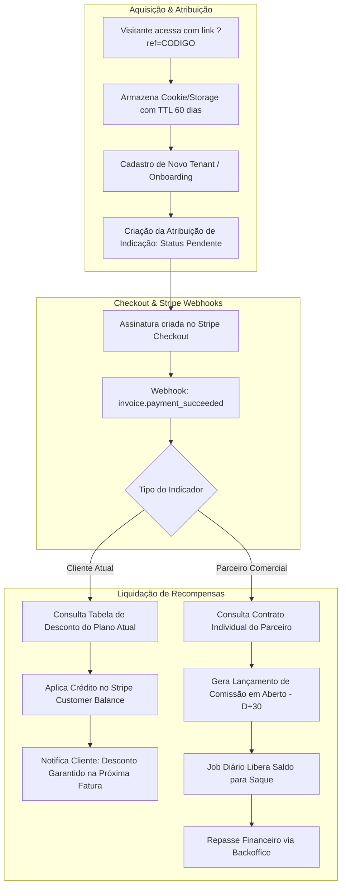

# Roadmap de Implementação: Programa de Indicação (Clientes & Parceiros Comerciais)

## 1. Visão Geral e Estratégia de Negócio

Este documento estabelece o plano de implementação do **Programa de Indicação do CriaCerto**, projetado para acelerar o crescimento da plataforma por meio de dois canais distintos com mecanismos de incentivo específicos:

1. **Clientes Atuais ("Indique e Ganhe")**:
   - **Incentivo**: Desconto aplicado diretamente na fatura/mensalidade do plano contratado.
   - **Cálculo**: O valor/percentual de desconto varia de acordo com o plano contratado pelo cliente indicador (e.g., Plano Starter, Pro, Enterprise).
   - **Mecanismo**: Abatimento automático via créditos de saldo no Stripe (`Customer Balance`) ou cupons de desconto vinculados à assinatura ativa.

2. **Parceiros Comerciais (Consultores, Representantes, Associações)**:
   - **Incentivo**: Comissão financeira líquida (repasse via Pix/transferência ou Stripe Transfers).
   - **Cálculo**: Valores e percentuais individualizados por parceiro, parametrizados no Backoffice com base em acordos comerciais (e.g., % recorrente, comissão fixa na primeira parcela, ou comissão escalonada).
   - **Mecanismo**: Extrato de comissões com retenção de carência (D+30) para proteção contra chargebacks/inadimplência e rotina de liquidação e repasse.

---

## 2. Regra de Conclusão por Sub-fase (Definition of Done)

> **Uma sub-fase só é considerada CONCLUÍDA quando:**
> 1. O código de backend (.NET) seguir arquitetura limpa, Result Pattern (`Result<T>`) e separação modular.
> 2. As migrações do Entity Framework Core estiverem geradas e validadas contra o banco relacional (PostgreSQL).
> 3. Os webhooks de pagamento (Stripe) possuírem tratamento idempotente e tolerante a falhas.
> 4. As interfaces Blazor (Web App) estiverem integradas às APIs, com validação de permissões e feedback visual claro.
> 5. Houver cobertura de testes unitários e de integração para regras de cálculo de desconto e comissão.
> 6. Regras de compliance e prevenção a fraudes (auto-indicação, cancelamento retroativo) estiverem ativas.

---

## 3. Matriz Comparativa de Regras

| Aspecto | Clientes Atuais | Parceiros Comerciais |
| :--- | :--- | :--- |
| **Público-alvo** | Produtores rurais / Fazendas ativas na plataforma. | Consultores agronômicos, veterinários, revendas e parceiros de negócio. |
| **Tipo de Recompensa** | Desconto em fatura da assinatura SaaS. | Comissão financeira repassada (R$). |
| **Forma de Liquidação** | Crédito em conta Stripe (`Customer Balance`) ou Cupom aplicado na assinatura. | Pagamento bancário / Pix registrado no Backoffice. |
| **Base do Cálculo** | Regra atrelada ao **Plano do Cliente Indicador**. | Regra configurada no **Contrato do Parceiro Comercial**. |
| **Teto de Recompensa** | Limitado a até 100% do valor da própria fatura mensal. | Sem teto, condicionado a faturamento mínimo para saque/repasse. |
| **Gatilho de Conversão** | Confirmação de primeiro pagamento do indicado (`invoice.payment_succeeded`). | Confirmação de pagamento do indicado com carência de 30 dias (D+30). |
| **Cancelamento do Indicado** | Cessa o benefício na fatura subsequente do cliente indicador. | Cancela comissões futuras; bloqueia parcelas pendentes de carência. |

---

## 4. Arquitetura da Solução e Fluxo de Dados



---

## 5. Detalhamento das Fases de Implementação

```
┌─────────────────────────────────────────────────────────────────┐
│ Fase 1: Modelagem de Domínio, Banco de Dados e Regras Base      │
└───────────────────────────────┬─────────────────────────────────┘
                                │
┌───────────────────────────────▼─────────────────────────────────┐
│ Fase 2: Atribuição no Onboarding e Integração com Stripe        │
└───────────────────────────────┬─────────────────────────────────┘
                                │
┌───────────────────────────────▼─────────────────────────────────┐
│ Fase 3: Módulo Backoffice para Gestão de Parceiros e Contratos  │
└───────────────────────────────┬─────────────────────────────────┘
                                │
┌───────────────────────────────▼─────────────────────────────────┐
│ Fase 4: Experiência do Cliente & Painel do Parceiro (Blazor)    │
└───────────────────────────────┬─────────────────────────────────┘
                                │
┌───────────────────────────────▼─────────────────────────────────┐
│ Fase 5: Jobs de Liquidação, Repasses e Proteção Anti-Fraude     │
└───────────────────────────────┬─────────────────────────────────┘
                                │
┌───────────────────────────────▼─────────────────────────────────┐
│ Fase 6: Observabilidade, Métricas de CAC/LTV e Go-to-Market     │
└─────────────────────────────────────────────────────────────────┘
```

---

### Fase 1: Modelagem de Domínio, Banco de Dados e Regras Base

#### 1.1 Entidades de Domínio (Módulo Dedicado: `Modules.Referral`)

> **Regra Fundamental de Elegibilidade Financeira:** O valor de recompensa (desconto em fatura ou comissão) **só será considerado e gerado para indicações que efetivamente pagarem os planos** (disparado via webhook de liquidação `invoice.payment_succeeded`). Cadastros em período de avaliação (*Trial*) ou contas sem fatura quitada geram apenas atribuição com status `Pending`, sem lançamento financeiro no ledger até a confirmação do pagamento.

- **`ReferralProgramParticipant`**:
  - `Id`, `TenantId` (Guid?, nulo para parceiros comerciais cadastrados pelo Backoffice sem fazenda própria), `UserId` (Guid?, opcional inicialmente para parceiros comerciais cadastrados por administradores), `ParticipantType` (`Customer` | `CommercialPartner`), `Status` (`Active`, `Suspended`), `SuspensionReason` (string?), `CreatedByAdminId` (Guid?), `CreatedAtUtc`, `UpdatedAtUtc`.
- **`ReferralCode`**:
  - `Id`, `ParticipantId`, `Code` (único, alfanumérico ou slug customizado em caixa alta normalizado), `CampaignTitle` (string?, identificação do canal/campanha, permitindo múltiplos códigos para parceiros comerciais), `ClicksCount`, `IsActive`, `CreatedAtUtc`.
- **`PartnerContract`** (Versionado - Histórico contratual):
  - `Id`, `ParticipantId`, `CommissionType` (`PercentageRecurring`, `PercentageFirstMonth`, `FixedPerConversion`), `CommissionValue` (decimal), `MaxRecurringMonths` (int?), `PaymentTermsDays` (default 30), `PixKey`, `PixKeyType` (`Cpf`, `Cnpj`, `Email`, `Phone`, `RandomKey`), `LegalDocumentNumber`, `ValidFromUtc`, `ValidToUtc` (DateTime?, nulo para contrato vigente atual), `IsActive`, `CreatedAtUtc`.
- **`PlanReferralDiscountPolicy`**:
  - `Id`, `PlanCatalogId`, `PlanCode`, `DiscountType` (`FixedValue`, `Percentage`), `DiscountValue`, `MaxDiscountCapPercentage` (default 100%), `IsActive`, `CreatedAtUtc`.
- **`ReferralAttribution`**:
  - `Id`, `ReferralCodeId`, `ReferrerParticipantId`, `ReferredTenantId`, `AttributionDateUtc`, `ConvertedAtUtc` (DateTime?, preenchido quando o primeiro pagamento for efetuado), `Status` (`Pending`, `Converted`, `Churned`, `Fraudulent`), `OriginIpAddress` (string?), `UserAgent` (string?), `DeviceFingerprintHash` (string?), `FraudReason` (string?).
- **`ReferralRewardLedger`**:
  - `Id`, `ReferralAttributionId`, `ParticipantId`, `RewardType` (`InvoiceDiscountCredit`, `CashCommission`), `GrossAmount`, `NetAmount`, `Currency` (BRL), `Status` (`PendingMaturity`, `AvailableForPayout`, `AppliedToInvoice`, `PaidOut`, `Cancelled`), `MaturityDateUtc`, `StripeInvoiceId`, `StripeCreditBalanceTransactionId`, `CancellationReason` (string?, para cancelamentos de cobrança/estorno), `CreatedAtUtc`.

#### 1.2 Migrações e Contexto EF Core [CONCLUÍDO]
- [x] Criação de `IReferralDbContext` na camada de aplicação (`CriaCerto.Modules.Referral.Application.Abstractions`).
- [x] Criação do projeto de infraestrutura `CriaCerto.Modules.Referral.Infrastructure` integrado à solução e ao host API.
- [x] Criação de `ReferralDbContext` com schema isolado `referral`, chaves primárias, chaves estrangeiras internas, mapeamentos fluentes e índices de busca rápida (`Code` [Unique], `ReferredTenantId`, `ReferralCodeId`, `ParticipantId`, `Status`, `MaturityDateUtc`).
- [x] Configuração de fábrica de tempo de design `ReferralDbContextFactory` e metadados de baseline em `MigrationBaselineMetadata.Referral`.
- [x] Geração e validação da migração inicial do EF Core `20261022010840_Initial_ReferralModule` no schema `referral`.
- [x] Testes unitários de mapeamento e ciclo de vida de persistência via SQLite em memória (`ReferralDbContextModelTests`) com 100% de sucesso.
- [x] Registro da migração do contexto na inicialização do host API (`ApplyMigrations`).
- [x] Criação da documentação arquitetural do módulo em `docs/modules/referral.md`.

---

### Fase 2: Atribuição no Onboarding e Integração com Stripe

#### 2.1 Rastreamento e Captura [CONCLUÍDO]
- [x] Middleware/endpoint Web e serviço cliente Blazor (`IReferralTrackingService`) para interceptar parâmetro `?ref={code}` e rota `/r/{code}`, salvando em cookie seguro `SameSite=Lax` e `localStorage`.
- [x] Registro assíncrono de contagem de cliques via `RecordReferralClickCommand` (`POST /api/v1/referral/clicks/{code}`) e consulta inline de validação via `ValidateReferralCodeQuery` (`GET /api/v1/referral/codes/validate/{code}`).
- [x] Inclusão do campo opcional no assistente de onboarding de novos tenants (`OnboardingWizard.razor`) e formulário de cadastro (`Register.razor`): "Código de Indicação / Consultor", com pré-preenchimento automático e feedback visual.
- [x] Associação do `TenantId` criado ao código do indicador no momento do provisionamento inicial via evento de integração in-process `TenantRegisteredIntegrationEvent` consumido por `TenantRegisteredReferralHandler`, com validação anti-auto-indicação, idempotência e atribuição em status `Pending`.
- [x] Suíte de testes unitários com 100% de sucesso cobrindo validação de código, registro de clique, bloqueio de auto-indicação e despacho de evento de integração.

#### 2.2 Eventos e Webhooks do Stripe
- Injeção da lógica de recompensa no fluxo de webhook do Stripe (`invoice.payment_succeeded`):
  - Verifica se o `Tenant` pagador possui uma `ReferralAttribution` ativa.
  - **Se o indicador for Cliente**:
    - Busca o plano contratado pelo indicador via `TenantSubscription`.
    - Consulta `PlanReferralDiscountPolicy` para identificar o valor do desconto.
    - Executa chamada ao Stripe (`CustomerBalanceTransactionService`) adicionando crédito na moeda local para abater automaticamente na próxima fatura.
    - Atualiza o registro em `ReferralRewardLedger` com status `AppliedToInvoice`.
  - **Se o indicador for Parceiro Comercial**:
    - Busca o contrato individual do parceiro em `PartnerContract`.
    - Calcula a comissão correspondente sobre o valor líquido da fatura.
    - Cria lançamento no `ReferralRewardLedger` com status `PendingMaturity` e `MaturityDateUtc = Today + 30 dias`.

---

### Fase 3: Módulo Backoffice para Gestão de Parceiros e Contratos

#### 3.1 Gestão de Parceiros Comerciais [CONCLUÍDO]
- [x] Interface completa no Backoffice (`/backoffice/partners`) com dashboard de KPIs, busca textual, filtros por status e comissão.
- [x] Cadastro de novos parceiros com dados cadastrais, CNPJ/CPF formatado e validado, e chave Pix.
- [x] Provisionamento automático de conta de usuário (`UserId`) via `IPartnerAccountProvisioner` e envio de convite por e-mail com senha temporária (`IEmailSender`).
- [x] Geração e sugestão inteligente de código/slug de indicação amigável com normalização (`ReferralCodeNormalizer`).
- [x] Definição individualizada de comissão:
  - Recorrente percentual com meses limitados (ex: 20% recorrente por 12 meses).
  - Fixo por conversão na primeira mensalidade confirmada (ex: R$ 350).
  - Vitalício percentual (ex: 10% vitalício sem limite de meses).
- [x] Governança Dual-Control (4-Eyes): propostas de reajuste de comissão submetidas como `AdminApprovalRequest` exigindo aprovação de outro administrador antes de atualizar vigência contratual.
- [x] Mascaramento de dados sensíveis (LGPD) no frontend com o componente `<MaskedDataField>` e trilha de auditoria forense com hash encadeado SHA-256.

#### 3.2 Painel Financeiro de Comissões e Repasses [CONCLUÍDO]
- [x] Dashboard financeiro no Backoffice (`/backoffice/referral/payouts`) com KPIs em tempo real (retido em carência, liberado para repasse e total pago no mês).
- [x] Grid de comissões pendentes de maturação com contagem regressiva visual do período de carência D+30 e ação de cancelamento com justificativa auditada.
- [x] Grid consolidado por Parceiro Comercial com drill-down (accordion) das comissões liberadas para pagamento.
- [x] Modal e fluxo de "Efetuar Baixa / Registrar Repasse" com upload obrigatório de comprovante em armazenamento local protegido e inserção de código/NSU/Pix End-to-End.
- [x] Exportação de lista de pagamentos em formato CSV padronizado com delimitador `;`, encoding UTF-8 com BOM e campos Pix para conciliação bancária em lote.
- [x] Trilha de auditoria forense com encadeamento de hash SHA-256 e proteção LGPD nativa com `<MaskedDataField>`.

#### 3.3 Configuração de Descontos por Plano [CONCLUÍDO]
- [x] Tela administrativa completa no Backoffice (`/backoffice/referral/discount-policies`) para calibrar os incentivos aos clientes por indicação ativa.
- [x] Dashboard de KPIs com contagem de planos, políticas ativas, modalidades (percentual vs valor fixo) e pendências de configuração.
- [x] Tabela de calibração interativa: Código do Plano x Nome x Modalidade x Desconto por Indicação Ativa x Teto Máximo x Status.
- [x] Modal interativo de parametrização com seletor de modalidade (Percentual `%` vs Fixo `R$`), inputs com validação e slider de teto máximo (`10% a 100%`).
- [x] Simulador de economia em tempo real para pré-visualização do impacto financeiro do cliente com 1, 2 ou 3 indicações ativas.
- [x] Ação de ativação/desativação rápida de política com feedback reativo e sem perda de histórico.
- [x] Integração modular desacoplada via `IPlanCatalogLookupService` consultando o catálogo sem acoplamento ou joins físicos cross-module.
- [x] Trilha de auditoria forense compulsória no `AuditLog` com encadeamento criptográfico SHA-256 para parametrização e alternância de status.
- [x] Matriz de segurança RBAC com permissões dedicadas `referral.discounts.read` e `referral.discounts.manage` atribuídas na matriz de perfis.
- [x] Suíte de testes unitários de domínio e casos de uso MediatR com 100% de sucesso.

---

### Fase 4: Experiência do Cliente & Painel do Parceiro (Blazor UI)

#### 4.1 Área "Indique e Ganhe" (Portal do Produtor / Cliente) [CONCLUÍDO]
- [x] Menu de fácil acesso na barra lateral em Configurações: **Indique e Ganhe** (`/settings/referrals` e `/referral`), com proteção RBAC para administradores/produtores autorizados.
- [x] Geração sob demanda de código e link exclusivo com base no nome da fazenda (com resolução de colisão numérica sequencial, ex: `FAZENDA-MODELO-2`).
- [x] Card de link individual com botão "Copiar Link" (clipboard com toast notification) e "Compartilhar no WhatsApp" (com texto pré-formatado e link parametrizado).
- [x] Modal interativo para o produtor personalizar o próprio código de indicação, com normalização de slug e validação de unicidade global.
- [x] Resumo de Economia com 3 KPIs em tempo real:
  - *Desconto acumulado na próxima fatura* calculado com base na política do plano ativo (`PlanReferralDiscountPolicy`), formatado em moeda brasileira `R$ 150,00` ou percentual.
  - *Amigos indicados com assinatura ativa* (fazendas com 1º pagamento quitado).
  - *Amigos em avaliação gratuita (Trial)* com indicação de benefício futuro.
- [x] Tabela de transparência com as fazendas indicadas com mascaramento LGPD determinístico (Regra Exemplo 3: primeira e última letra mantidas, intermediárias com asteriscos, ex: `F*****a S***a M***a`), data de cadastro, status do benefício e impacto na mensalidade.
- [x] Desacoplamento modular estrito via `ITenantInfoLookupService` no Host, sem joins cross-module entre os schemas `referral` e `tenancy`.
- [x] Cobertura de testes unitários de domínio, handlers MediatR e API Client com 100% de sucesso.

#### 4.2 Portal Exclusivo do Parceiro Comercial [CONCLUÍDO]
- [x] Portal dedicado e independente em `/partner/portal` e `/partner` com layout exclusivo (`PartnerLayout.razor`) focado em conversão e resultados comerciais.
- [x] Autenticação unificada com suporte a parceiros sem fazenda (`IPartnerRoleLookupService`), emitindo JWT com role `CommercialPartner` e redirecionando automaticamente para o portal.
- [x] Grid de 6 KPIs comerciais e financeiros:
  - *Total de Cliques* com cálculo dinâmico da taxa de conversão (`ConversionRatePercentage`).
  - *Cadastros em Avaliação Gratuita (Trial)* (`Pending`).
  - *Assinaturas Pagas Ativas* (`Converted`).
  - *Saldo Pendente de Carência D+30* (`PendingMaturity`).
  - *Saldo Liberado para Saque* (`AvailableForPayout`).
  - *Total Repassado Acumulado* (`PaidOut`).
- [x] Gestão de links de divulgação e suporte a múltiplas campanhas (`ReferralCode` com `CampaignTitle`):
  - Card oficial com botão de copiar link e compartilhamento no WhatsApp pré-formatado.
  - Tabela de campanhas secundárias com contagem individual de cliques.
  - Modal interativo para criação de nova campanha com slug customizado e validação de unicidade.
- [x] Modal de cadastro e edição de chave Pix para recebimento das comissões com validação por tipo (CPF, CNPJ, E-mail, Telefone, Chave Aleatória) atualizando o contrato ativo (`UpdatePartnerPixKeyCommand`).
- [x] Histórico e extrato completo de comissões com filtros dinâmicos por período, status de liquidação e busca textual por fazenda indicada.
- [x] Desacoplamento modular via `ITenantInfoLookupService` no Host, exibindo a visão completa do cliente indicado sem joins físicos cross-module.
- [x] Cobertura de testes unitários para domínio, queries, commands, autenticação e cliente HTTP com 100% de sucesso.

---

### Fase 5: Jobs de Liquidação, Repasses e Proteção Anti-Fraude

#### 5.1 Background Job (`ReferralMaturityAndEnforcementJob`) [CONCLUÍDO]
- [x] Worker em segundo plano agendado via `BackgroundService` e `PeriodicTimer` (`ReferralMaturityAndEnforcementWorker`), configurado com intervalo diário e atraso inicial (`ReferralEnforcementOptions`).
- [x] Liberação de maturação D+30: identifica comissões de parceiros comerciais (`RewardType.CashCommission`) em `PendingMaturity` com `MaturityDateUtc <= Now` e transiciona compulsoriamente para `AvailableForPayout`.
- [x] Estratégia Híbrida de Estorno Stripe (Opção C):
  - Camada Reativa em tempo real: recebimento de webhook `charge.refunded` no `StripePaymentService`, despachando evento in-process `StripeChargeRefundedIntegrationEvent` tratado por `StripeChargeRefundedReferralHandler` para cancelamento imediato de comissões pendentes.
  - Checagem Ativa preventiva no Job: verificação remota via `IReferralPaymentVerificationService` (`StripePaymentVerificationService`) no Host API para faturas canceladas (`void`, `uncollectible`) ou com notas de crédito pós-pagamento (`PostPaymentCreditNotesAmount > 0`).
- [x] Tratamento de inadimplência e cancelamento da fazenda indicada:
  - Consulta desacoplada via `ITenantInfoLookupService.GetTenantSummariesAsync(...)`.
  - Caso a fazenda indicada esteja em status `PastDue`, `Cancelled` ou `Suspended`, cancela compulsoriamente os lançamentos pendentes (`Status = Cancelled`) e migra o status da indicação (`ReferralAttribution`) para `Churned`.
- [x] Auditoria forense imutável com hash SHA-256 encadeado:
  - Abstração `IReferralAuditSink` implementada no Host (`ReferralBackofficeAuditSink`) registrando eventos `Referral.CommissionCancelled.TenantInsolvent`, `Referral.CommissionCancelled.StripeRefund` e `Referral.CommissionCancelled.WebhookRefund` no `AuditLog` do Backoffice.
- [x] Endpoint administrativo no Backoffice (`POST /api/v1/backoffice/referral/payouts/run-enforcement`) para disparo sob demanda do ciclo pelo operador financeiro com claim `referral.payouts.manage`.
- [x] Cobertura abrangente de testes unitários (`ReferralMaturityEnforcementTests`, `StripeChargeRefundedReferralHandlerTests`) e integração arquitetural de ponta a ponta (`ReferralMaturityWorkerIntegrationTests`) com 100% de sucesso.

#### 5.2 Regras de Prevenção a Abusos e Fraudes [CONCLUÍDO]
- [x] **Bloqueio de Auto-Indicação no Cadastro e Validação Cruzada**:
  - Detecção imediata em `TenantRegisteredReferralHandler`: impede indicação entre contas com mesmo CPF/CNPJ (inclusive parceiros comerciais via `PartnerContract.LegalDocumentNumber`), mesmo titular/e-mail (`TechnicalOwnerEmail`, `CommercialOwnerEmail` ou e-mail de registro) ou mesmo `TenantId`.
  - Em caso de colisão, transiciona compulsoriamente para `AttributionStatus.Fraudulent` com `FraudReason` descritivo e grava evento imutável no `AuditLog` do Backoffice via `IReferralAuditSink` (`Referral.AntiFraud.SelfReferralBlocked`).
- [x] **Bloqueio de Fraude por Cartão de Crédito Coincidente (Stripe) & Suspensão Preventiva**:
  - Interceptação em tempo real via evento de domínio `TenantPaymentSucceededIntegrationEvent` em `TenantPaymentSucceededReferralHandler`:
  - Validação remota no Stripe (`HasCardFingerprintCollisionAsync`) comparando o `fingerprint` dos cartões do pagante com os do cliente indicador.
  - Se colidir, cancela a conversão para `Fraudulent`, bloqueia a recompensa no ledger, suspende o participante indicador preventivamente (`ParticipantStatus.Suspended`) e gera log forense de severidade crítica no Backoffice.
- [x] **Validação e Governança de Limite de Desconto (Teto de 100%)**:
  - Blindagem invariante no motor de cálculo em `PlanReferralDiscountPolicy.CalculateDiscount`: o abatimento acumulado (fixo ou percentual) é estritamente limitado ao teto de 100% da assinatura base do período atual.
  - O desconto do cliente nunca poderá gerar saldo negativo a pagar ou transferência de dinheiro de volta ao cliente.
  - Projeção no Dashboard do cliente (`GetCustomerReferralDashboardQuery`) atualizada com o valor base do plano e indicação visual de limite atingido.
  - Validação defensiva no ledger em `ReferralRewardLedger.CreateInvoiceDiscountCredit` com `maxInvoiceAmount`.
- [x] **Governança 4-Eyes e Auditoria Forense em Alteração de Contrato**:
  - Toda modificação contratual de comissão de parceiro comercial em `UpdatePartnerContractCommissionCommandHandler` emite compulsoriamente registro de auditoria forense no `AuditLog` do Backoffice com hash SHA-256 encadeado (`Referral.PartnerContract.CommissionUpdated`) com diff completo (`OldContract` vs `NewContract`).
  - Governança de aprovação dupla (princípio 4-Eyes) implementada e validada via `AdminApprovalRequest` com `ApprovalRequestType.UpdatePartnerContractCommission`, rejeitando auto-aprovação (`ApprovalErrors.CannotSelfApprove`) e auditando a execução autorizada por um segundo operador.
- [x] Cobertura abrangente de testes unitários para anti-fraude de cadastro, colisão de cartão de crédito Stripe, limitação de 100% de desconto e aprovação 4-Eyes com 100% de sucesso.

---

### Fase 6: Observabilidade, Métricas de CAC/LTV e Go-to-Market

#### 6.1 Telemetria e Indicadores de Sucesso (KPIs) [CONCLUÍDO]
- [x] **CAC por Canal**:
  - Consolidação analítica do CAC para **Clientes** (descontos concedidos em `ReferralRewardLedger`), **Parceiros Comerciais** (comissões líquidas) e **Mídia Paga** (lançamentos de investimentos em Google/Meta Ads na entidade `PaidMediaSpend` no Backoffice).
  - Cálculo de CAC individual por canal e Blended CAC (custo total / aquisições totais) com proteção contra divisão por zero.
- [x] **Taxa de Conversão do Funil**:
  - Acompanhamento granular: Cliques (`ReferralCode.ClicksCount`) ➔ Cadastros Trial (`ReferralAttribution` / `Pending`) ➔ Faturas Pagas (`Converted`).
  - Taxas de conversão desdobradas (Clique para Lead, Lead para Pagante e Conversão Global).
- [x] **LTV e Retenção de Indicados**:
  - Comparativo de tempo médio de permanência em dias (clientes indicados vs média geral da plataforma) e taxas relativas de retenção e churn obtidas via serviço desacoplado (`ITenantInfoLookupService.GetTenantsRetentionMetricsAsync`).
- [x] **Índice de Viralidade (K-Factor)**:
  - Cálculo clássico: novos clientes adquiridos via indicação de produtores dividido pelo total de clientes ativos na plataforma (`ITenantInfoLookupService.GetActiveTenantsCountAsync`).
  - Classificação dinâmica entre *Subcrítico* ($K < 1.0$) e *Viral Expansivo* ($K \ge 1.0$).
- [x] **Telemetria Nativa .NET 10 (`ReferralTelemetry`)**:
  - `Meter("CriaCerto.Modules.Referral", "1.0.0")` e `ActivitySource` com contadores para `referral.clicks.total`, `referral.attributions.total`, `referral.rewards.total`, `referral.rewards.amount` e histograma de latência `referral.operation_latency.duration_ms`.
- [x] **Dashboard Analítico no Backoffice Blazor & API**:
  - Rota `/backoffice/referral/analytics` com seletores de período rápido (30d, mês atual, 90d, todo o período, personalizado), cards de KPIs, gráficos de funil, comparativo de CAC e modal de lançamento de despesas de mídia paga.
  - Endpoints REST `/api/v1/backoffice/referral/kpis`, `/api/v1/backoffice/marketing/paid-media` (GET e POST) sob as claims `referral.analytics.read` e `referral.analytics.manage`.
- [x] Cobertura abrangente de testes unitários (`PaidMediaSpendTests`, `ReferralTelemetryTests`, `GetReferralProgramKpisQueryTests`) e integração com 100% de sucesso.

#### 6.2 Testes Automatizados e Homologação [CONCLUÍDO]
- [x] **Testes Unitários**:
  - **Motor de cálculo de desconto por plano de cliente (`PlanDiscountEngineTests`, `PlanReferralDiscountPolicyTests`)**:
    - Políticas percentuais e de valor fixo com múltiplos amigos indicados.
    - Limite customizado (`MaxDiscountCapPercentage`) e teto estrito de 100% da assinatura base (clamping, sem saldo negativo nem dinheiro de volta).
    - Inativação de política (`IsActive = false`), preços-base nulos/negativos e contagem zero/negativa de amigos retornando desconto zero de forma defensiva.
  - **Motor de cálculo de comissão de parceiro comercial (`PartnerCommissionEngineTests`, `PartnerContractTests`)**:
    - Regra de percentual no primeiro mês (`CommissionType.PercentageFirstMonth`), com cálculo exato no ciclo 1 e retorno zero nos ciclos subsequentes.
    - Regra de percentual recorrente (`CommissionType.PercentageRecurring`), cobrindo tanto contratos com teto de meses (`MaxRecurringMonths`) quanto contratos contínuos/vitalícios (`MaxRecurringMonths = null`).
    - Regra de valor fixo por conversão (`CommissionType.FixedPerConversion`), com liberação no ciclo 1 e zero nas renovações periódicas.
    - Contratos cancelados/fechados (`ValidToUtc`), valores inválidos de fatura e validação de ciclo.
- [x] **Testes de Integração**:
  - **Simulação de ciclo de vida completo via webhooks Stripe Mock/Sandbox (`ReferralStripeWebhookLifecycleIntegrationTests`)**:
    - Recebimento de webhook `checkout.session.completed` assinado com HMAC-SHA256: ativação do Tenant, publicação de `TenantPaymentSucceededIntegrationEvent`, transição da atribuição para `Converted` e criação de recompensa em `RewardLedger` com status `PendingMaturity` (carência D+30).
    - Recebimento de webhook `charge.refunded` assinado com HMAC-SHA256: publicação de `StripeChargeRefundedIntegrationEvent`, cancelamento compulsório da comissão pendente (`Status = Cancelled`) e geração de registro forense imutável via `IReferralAuditSink`.
  - **Fluxo de carência D+30 e concorrência de pagamentos (`ReferralMaturityAndPaymentConcurrencyIntegrationTests`)**:
    - Carência estrita D+30: simulação de execução do worker no Dia 15 (retém comissões em `PendingMaturity`) e no Dia 31 (libera compulsoriamente para `AvailableForPayout`).
    - Concorrência e idempotência: disparo paralelo de 5 eventos simultâneos para a mesma fatura Stripe garantindo que apenas 1 lançamento seja gerado no ledger sem race conditions.
    - Ciclos mensais sucessivos de parceiro comercial: concessão mês a mês e bloqueio após o teto contratual de meses.

---

## 6. Cronograma Estimativo de Execução

| Sprint / Semana | Escopo Principal | Entregáveis |
| :--- | :--- | :--- |
| **Semanas 1 e 2** | Modelagem de Domínio & DB | Entidades, DbContext, Migrations e DTOs base. |
| **Semanas 3 e 4** | Webhooks Stripe & Motor de Cálculo | Rastreamento de URLs, atribuição e liquidação no Stripe Balance. |
| **Semana 5** | Backoffice de Gestão Comercial | Telas de contratos de parceiros, aprovação de repasses e auditoria. |
| **Semanas 6 e 7** | Frontend Blazor (Cliente e Parceiro) | Tela "Indique e Ganhe" para clientes e Dashboard do Parceiro. |
| **Semana 8** | Jobs de Maturação & Anti-Fraude | Job de liberação D+30, proteção contra auto-indicação e estornos. |
| **Semana 9** | Testes de Carga, Métricas & Go-Live | Homologação ponta a ponta no Stripe Sandbox e deploy em produção. |
