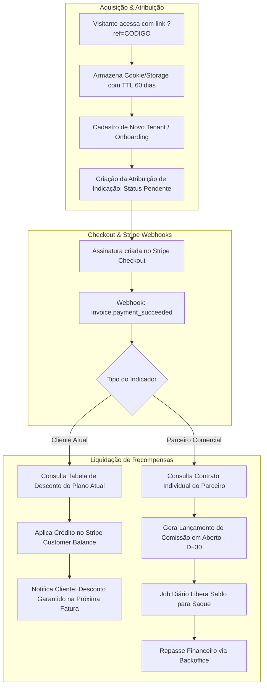

# Roadmap de Implementação: Programa de Indicação (Clientes & Parceiros Comerciais)

## 1. Visão Geral e Estratégia de Negócio

Este documento estabelece o plano de implementação do **Programa de Indicação do CriaCerto**, projetado para acelerar o crescimento da plataforma por meio de dois canais distintos com mecanismos de incentivo específicos:

1. **Clientes Atuais ("Indique e Ganhe")**:
   - **Incentivo**: Desconto aplicado diretamente na fatura/mensalidade do plano contratado.
   - **Cálculo**: O valor/percentual de desconto varia de acordo com o plano contratado pelo cliente indicador (e.g., Plano Starter, Pro, Enterprise).
   - **Mecanismo**: Abatimento automático via créditos de saldo no Stripe (`Customer Balance`) ou cupons de desconto vinculados à assinatura ativa.

2. **Parceiros Comerciais (Consultores, Representantes, Associações)**:
   - **Incentivo**: Comissão financeira líquida (repasse via Pix/transferência ou Stripe Transfers).
   - **Cálculo**: Valores e percentuais individualizados por parceiro, parametrizados no Backoffice com base em acordos comerciais (e.g., % recorrente, comissão fixa na primeira parcela, ou comissão escalonada).
   - **Mecanismo**: Extrato de comissões com retenção de carência (D+30) para proteção contra chargebacks/inadimplência e rotina de liquidação e repasse.

---

## 2. Regra de Conclusão por Sub-fase (Definition of Done)

> **Uma sub-fase só é considerada CONCLUÍDA quando:**
> 1. O código de backend (.NET) seguir arquitetura limpa, Result Pattern (`Result<T>`) e separação modular.
> 2. As migrações do Entity Framework Core estiverem geradas e validadas contra o banco relacional (PostgreSQL).
> 3. Os webhooks de pagamento (Stripe) possuírem tratamento idempotente e tolerante a falhas.
> 4. As interfaces Blazor (Web App) estiverem integradas às APIs, com validação de permissões e feedback visual claro.
> 5. Houver cobertura de testes unitários e de integração para regras de cálculo de desconto e comissão.
> 6. Regras de compliance e prevenção a fraudes (auto-indicação, cancelamento retroativo) estiverem ativas.

---

## 3. Matriz Comparativa de Regras

| Aspecto | Clientes Atuais | Parceiros Comerciais |
| :--- | :--- | :--- |
| **Público-alvo** | Produtores rurais / Fazendas ativas na plataforma. | Consultores agronômicos, veterinários, revendas e parceiros de negócio. |
| **Tipo de Recompensa** | Desconto em fatura da assinatura SaaS. | Comissão financeira repassada (R$). |
| **Forma de Liquidação** | Crédito em conta Stripe (`Customer Balance`) ou Cupom aplicado na assinatura. | Pagamento bancário / Pix registrado no Backoffice. |
| **Base do Cálculo** | Regra atrelada ao **Plano do Cliente Indicador**. | Regra configurada no **Contrato do Parceiro Comercial**. |
| **Teto de Recompensa** | Limitado a até 100% do valor da própria fatura mensal. | Sem teto, condicionado a faturamento mínimo para saque/repasse. |
| **Gatilho de Conversão** | Confirmação de primeiro pagamento do indicado (`invoice.payment_succeeded`). | Confirmação de pagamento do indicado com carência de 30 dias (D+30). |
| **Cancelamento do Indicado** | Cessa o benefício na fatura subsequente do cliente indicador. | Cancela comissões futuras; bloqueia parcelas pendentes de carência. |

---

## 4. Arquitetura da Solução e Fluxo de Dados



---

## 5. Detalhamento das Fases de Implementação

```
┌─────────────────────────────────────────────────────────────────┐
│ Fase 1: Modelagem de Domínio, Banco de Dados e Regras Base      │
└───────────────────────────────┬─────────────────────────────────┘
                                │
┌───────────────────────────────▼─────────────────────────────────┐
│ Fase 2: Atribuição no Onboarding e Integração com Stripe        │
└───────────────────────────────┬─────────────────────────────────┘
                                │
┌───────────────────────────────▼─────────────────────────────────┐
│ Fase 3: Módulo Backoffice para Gestão de Parceiros e Contratos  │
└───────────────────────────────┬─────────────────────────────────┘
                                │
┌───────────────────────────────▼─────────────────────────────────┐
│ Fase 4: Experiência do Cliente & Painel do Parceiro (Blazor)    │
└───────────────────────────────┬─────────────────────────────────┘
                                │
┌───────────────────────────────▼─────────────────────────────────┐
│ Fase 5: Jobs de Liquidação, Repasses e Proteção Anti-Fraude     │
└───────────────────────────────┬─────────────────────────────────┘
                                │
┌───────────────────────────────▼─────────────────────────────────┐
│ Fase 6: Observabilidade, Métricas de CAC/LTV e Go-to-Market     │
└─────────────────────────────────────────────────────────────────┘
```

---

### Fase 1: Modelagem de Domínio, Banco de Dados e Regras Base

#### 1.1 Entidades de Domínio (Módulo Dedicado: `Modules.Referral`)

> **Regra Fundamental de Elegibilidade Financeira:** O valor de recompensa (desconto em fatura ou comissão) **só será considerado e gerado para indicações que efetivamente pagarem os planos** (disparado via webhook de liquidação `invoice.payment_succeeded`). Cadastros em período de avaliação (*Trial*) ou contas sem fatura quitada geram apenas atribuição com status `Pending`, sem lançamento financeiro no ledger até a confirmação do pagamento.

- **`ReferralProgramParticipant`**:
  - `Id`, `TenantId` (Guid?, nulo para parceiros comerciais cadastrados pelo Backoffice sem fazenda própria), `UserId` (Guid?, opcional inicialmente para parceiros comerciais cadastrados por administradores), `ParticipantType` (`Customer` | `CommercialPartner`), `Status` (`Active`, `Suspended`), `SuspensionReason` (string?), `CreatedByAdminId` (Guid?), `CreatedAtUtc`, `UpdatedAtUtc`.
- **`ReferralCode`**:
  - `Id`, `ParticipantId`, `Code` (único, alfanumérico ou slug customizado em caixa alta normalizado), `CampaignTitle` (string?, identificação do canal/campanha, permitindo múltiplos códigos para parceiros comerciais), `ClicksCount`, `IsActive`, `CreatedAtUtc`.
- **`PartnerContract`** (Versionado - Histórico contratual):
  - `Id`, `ParticipantId`, `CommissionType` (`PercentageRecurring`, `PercentageFirstMonth`, `FixedPerConversion`), `CommissionValue` (decimal), `MaxRecurringMonths` (int?), `PaymentTermsDays` (default 30), `PixKey`, `PixKeyType` (`Cpf`, `Cnpj`, `Email`, `Phone`, `RandomKey`), `LegalDocumentNumber`, `ValidFromUtc`, `ValidToUtc` (DateTime?, nulo para contrato vigente atual), `IsActive`, `CreatedAtUtc`.
- **`PlanReferralDiscountPolicy`**:
  - `Id`, `PlanCatalogId`, `PlanCode`, `DiscountType` (`FixedValue`, `Percentage`), `DiscountValue`, `MaxDiscountCapPercentage` (default 100%), `IsActive`, `CreatedAtUtc`.
- **`ReferralAttribution`**:
  - `Id`, `ReferralCodeId`, `ReferrerParticipantId`, `ReferredTenantId`, `AttributionDateUtc`, `ConvertedAtUtc` (DateTime?, preenchido quando o primeiro pagamento for efetuado), `Status` (`Pending`, `Converted`, `Churned`, `Fraudulent`), `OriginIpAddress` (string?), `UserAgent` (string?), `DeviceFingerprintHash` (string?), `FraudReason` (string?).
- **`ReferralRewardLedger`**:
  - `Id`, `ReferralAttributionId`, `ParticipantId`, `RewardType` (`InvoiceDiscountCredit`, `CashCommission`), `GrossAmount`, `NetAmount`, `Currency` (BRL), `Status` (`PendingMaturity`, `AvailableForPayout`, `AppliedToInvoice`, `PaidOut`, `Cancelled`), `MaturityDateUtc`, `StripeInvoiceId`, `StripeCreditBalanceTransactionId`, `CancellationReason` (string?, para cancelamentos de cobrança/estorno), `CreatedAtUtc`.

#### 1.2 Migrações e Contexto EF Core
- Criação das tabelas no contexto de dados com chaves estrangeiras, índices de busca rápida (`Code`, `ReferredTenantId`) e soft delete se aplicável.

---

### Fase 2: Atribuição no Onboarding e Integração com Stripe

#### 2.1 Rastreamento e Captura
- Middleware ou componente Blazor para interceptar parâmetro `?ref={code}` e salvar em cookie seguro HTTP-only / storage.
- Inclusão do campo opcional no formulário de registro de novos tenants: "Código de Indicação / Consultor".
- Associação do `TenantId` criado ao código do indicador no momento do provisionamento inicial.

#### 2.2 Eventos e Webhooks do Stripe
- Injeção da lógica de recompensa no fluxo de webhook do Stripe (`invoice.payment_succeeded`):
  - Verifica se o `Tenant` pagador possui uma `ReferralAttribution` ativa.
  - **Se o indicador for Cliente**:
    - Busca o plano contratado pelo indicador via `TenantSubscription`.
    - Consulta `PlanReferralDiscountPolicy` para identificar o valor do desconto.
    - Executa chamada ao Stripe (`CustomerBalanceTransactionService`) adicionando crédito na moeda local para abater automaticamente na próxima fatura.
    - Atualiza o registro em `ReferralRewardLedger` com status `AppliedToInvoice`.
  - **Se o indicador for Parceiro Comercial**:
    - Busca o contrato individual do parceiro em `PartnerContract`.
    - Calcula a comissão correspondente sobre o valor líquido da fatura.
    - Cria lançamento no `ReferralRewardLedger` com status `PendingMaturity` e `MaturityDateUtc = Today + 30 dias`.

---

### Fase 3: Módulo Backoffice para Gestão de Parceiros e Contratos

#### 3.1 Gestão de Parceiros Comerciais
- Interface para cadastro de novos parceiros com dados cadastrais, CNPJ/CPF e chave Pix.
- Definição individualizada de comissão:
  - Exemplo Parceiro A: 20% recorrente por 12 meses.
  - Exemplo Parceiro B: R$ 350 fixo na primeira mensalidade confirmada.
  - Exemplo Parceiro C: 10% vitalício enquanto o indicado mantiver assinatura ativa.

#### 3.2 Painel Financeiro de Comissões e Repasses
- Grid de comissões pendentes de maturação (período de carência D+30).
- Grid de comissões liberadas para pagamento.
- Botão de ação "Efetuar Baixa / Registrar Repasse" com upload de comprovante ou inserção de código de transação bancária.
- Exportação de lista de pagamentos em formato CSV/Excel/CNAB para lote Pix.

#### 3.3 Configuração de Descontos por Plano
- Tela administrativa para calibrar os descontos concedidos aos clientes:
  - Tabela: Código do Plano x Desconto por Indicação Ativa x Teto Máximo.

---

### Fase 4: Experiência do Cliente & Painel do Parceiro (Blazor UI)

#### 4.1 Área "Indique e Ganhe" (Portal do Produtor / Cliente)
- Menu de fácil acesso na barra lateral: **Indicações**.
- Card com o link individual: `criacerto.com/r/FAZENDA-MODELO` com botão "Copiar Link" e "Compartilhar no WhatsApp".
- Resumo de Economia:
  - *Desconto acumulado na próxima fatura*: `R$ 150,00`.
  - *Amigos indicados com assinatura ativa*: `3 fazendas`.
- Tabela de transparência com as fazendas indicadas (nome resumido/mascarado e status do benefício).

#### 4.2 Portal Exclusivo do Parceiro Comercial
- Visão focada em conversão e resultados comerciais:
  - Total de cliques no link.
  - Quantidade de cadastros trial vs assinaturas pagas.
  - Saldo acumulado (Pendente de Carência vs Liberado para Saque vs Total Pago).
- Histórico completo de extrato com filtros por data e por cliente indicado.
- Cadastro e edição de chave Pix para recebimento das comissões.

---

### Fase 5: Jobs de Liquidação, Repasses e Proteção Anti-Fraude

#### 5.1 Background Job (`ReferralMaturityAndEnforcementJob`)
- Execução diária agendada via Quartz / Worker:
  - Identifica lançamentos no ledger com `MaturityDateUtc <= Now` e migra de `PendingMaturity` para `AvailableForPayout`.
  - Verifica se houve estorno/reembolso no Stripe (`charge.refunded` ou cancelamento imediato); se sim, cancela os créditos pendentes.
  - Trata suspensão ou inadimplência do indicado: interrompe repasses recorrentes caso a fazenda indicada fique em status `PastDue` ou `Cancelled`.

#### 5.2 Regras de Prevenção a Abusos e Fraudes
- **Bloqueio de Auto-Indicação**:
  - Validação cruzada impedindo indicação entre contas com mesmo CPF/CNPJ, mesmo titular ou mesmo cartão de crédito registrado no Stripe.
- **Validação de Limite de Desconto**:
  - O desconto do cliente nunca poderá gerar saldo negativo a pagar ou transferência de dinheiro de volta ao cliente; o abatimento é limitado a 100% da assinatura do período.
- **Auditoria de Alteração de Contrato**:
  - Toda modificação na taxa de comissão de um parceiro comercial gera log imutável de auditoria no Backoffice.

---

### Fase 6: Observabilidade, Métricas de CAC/LTV e Go-to-Market

#### 6.1 Telemetria e Indicadores de Sucesso (KPIs)
- **CAC por Canal**: Custo de aquisição via indicação de clientes vs parceiros vs mídia paga.
- **Taxa de Conversão**: Percentual de cliques no link de indicação que resultaram em cadastro e faturas pagas.
- **LTV de Indicados**: Comparativo de retenção e tempo médio de permanência de clientes vindos de indicação.
- **Índice de Viralidade (K-Factor)**: Média de novos clientes gerados por cada cliente ativo.

#### 6.2 Testes Automatizados e Homologação
- **Testes Unitários**:
  - Testes do motor de cálculo de desconto por plano de cliente.
  - Testes do motor de cálculo de comissão com diferentes regras contratuais de parceiro.
- **Testes de Integração**:
  - Simulação de ciclo de vida completo via webhooks do Stripe Mock/Sandbox.
  - Teste de fluxo de carência D+30 e concorrência de pagamentos.

---

## 6. Cronograma Estimativo de Execução

| Sprint / Semana | Escopo Principal | Entregáveis |
| :--- | :--- | :--- |
| **Semanas 1 e 2** | Modelagem de Domínio & DB | Entidades, DbContext, Migrations e DTOs base. |
| **Semanas 3 e 4** | Webhooks Stripe & Motor de Cálculo | Rastreamento de URLs, atribuição e liquidação no Stripe Balance. |
| **Semana 5** | Backoffice de Gestão Comercial | Telas de contratos de parceiros, aprovação de repasses e auditoria. |
| **Semanas 6 e 7** | Frontend Blazor (Cliente e Parceiro) | Tela "Indique e Ganhe" para clientes e Dashboard do Parceiro. |
| **Semana 8** | Jobs de Maturação & Anti-Fraude | Job de liberação D+30, proteção contra auto-indicação e estornos. |
| **Semana 9** | Testes de Carga, Métricas & Go-Live | Homologação ponta a ponta no Stripe Sandbox e deploy em produção. |
